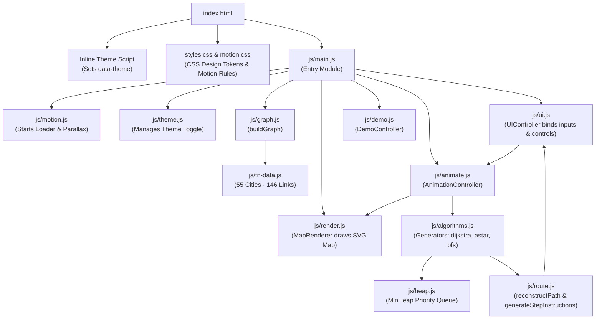
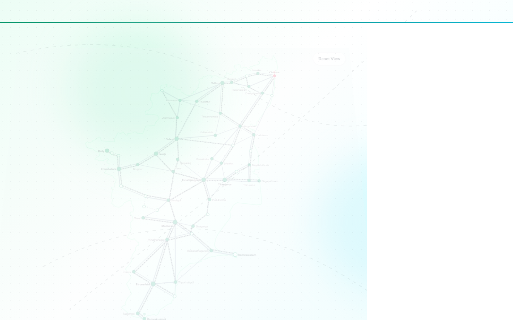
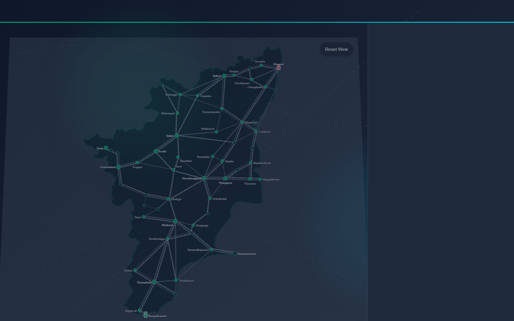
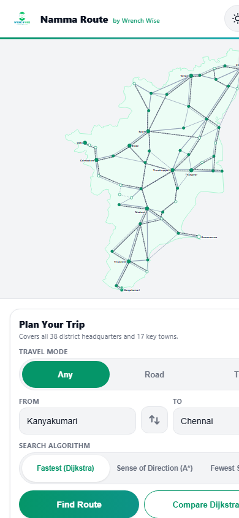
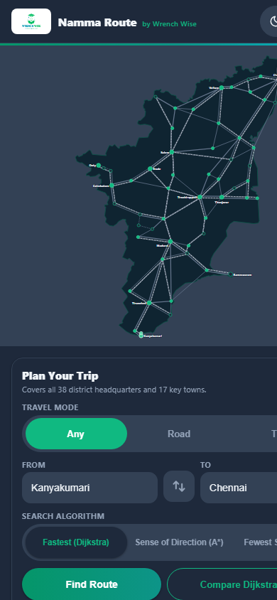
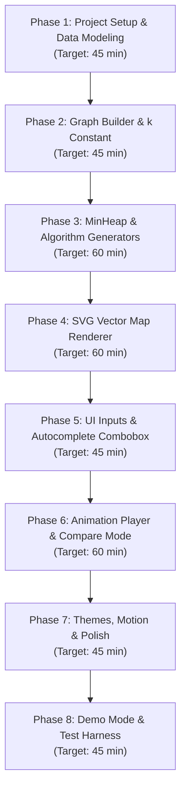

# Namma Route: Complete Project Details

---

## 1. Quick Summary

Namma Route is an interactive transit route finder and algorithm visualizer that models the road and rail networks across the state of Tamil Nadu, India. A person chooses a starting city and a destination city, and the application shows how computer algorithms explore the map step by step to find the best route.

### Project Fact Table

| Fact | Value | Source in Project |
|---|---|---|
| Project Name | Namma Route | (index.html, line 9) |
| Brand Ownership | Wrench Wise | (index.html, line 106) |
| Author | B Pradeep | (README.md, line 6; LICENSE, line 3) |
| Live Web Link | https://nammaroute-sigma.vercel.app/ | (README.md, line 3) |
| GitHub Repository | https://github.com/Pradeep-B28/Namma_Route.git | (git remote -v) |
| Active Branch | main | (git branch) |
| Last Git Update Date | 02 November 2026 | (git log commit 9b1ca2e) |
| Total Project Files | 36 files (32 root files and 4 generated screenshots) | (Folder scan) |
| Code and Data Text Files | 24 files | (Folder scan) |
| Total Lines of Code and Text | 5087 lines | (File measurement) |
| Cities on Map | 55 cities | (js/tn-data.js, CITIES) |
| District Headquarters | 38 cities | (js/tn-data.js, CITIES) |
| Rail-Connected Cities | 49 cities | (js/tn-data.js, CITIES) |
| Road Links (Highways, State, Ghat) | 86 links | (js/tn-data.js, ROAD_LINKS) |
| Rail Links (Main, Branch, Hill) | 60 links | (js/tn-data.js, RAIL_LINKS) |
| Logical Graph Nodes | 104 nodes (55 road nodes and 49 rail nodes) | (js/graph.js, buildGraph) |
| Directed Graph Edges | 390 edges (172 road, 120 rail, and 98 transfer) | (js/graph.js, buildGraph) |
| Admissible Heuristic Ratio k | 1.0061919047544836 minutes per kilometer | (js/graph.js, buildGraph) |
| Automated Test Assertions | 8292 city pairs tested with 0 failures | (js/test.js, runSelfTest) |
| Software License | MIT License | (LICENSE, lines 1 to 21) |

---

## 2. Purpose

### The Problem It Solves
When a person travels across Tamil Nadu, finding the fastest way between two cities depends on whether they drive by road, take a train, or combine both. Most commercial map applications return a route instantly without showing how the decision was made. 

Namma Route solves this by opening the computer's thinking process. It visualizes how pathfinding algorithms (step-by-step search procedures) explore a network. It makes abstract computer science concepts visible to everyone by showing search ripples spreading across actual geography (js/render.js, animateCityVisit).

### Who It Is For
1. Students learning Data Structures and Algorithms (known as DSA). It shows how algorithms work on a real state transit network with actual travel times (EXPLAINER.md, lines 1 to 7).
2. Social media viewers and learners without technical backgrounds. It provides clean visuals and automated demonstrations that make sense within 5 seconds (REEL_SCRIPT.md, lines 11 to 23).
3. Teachers, parents, and prospective students evaluating Wrench Wise educational standards. It demonstrates quality craftsmanship with zero external libraries (index.html, lines 98 to 110).

### Why It Was Built
Pathfinding algorithms are usually taught using abstract textbook diagrams with circles and letters like A, B, and C. Students often struggle to understand why A* (pronounced "A-star") is faster than Dijkstra's algorithm. 

Namma Route was built to give students immediate visual intuition. In Compare mode, the user sees Dijkstra search in all directions across 49 cities, while A* uses a sense of direction to reach Chennai in only 16 city inspections. Both algorithms find the exact same 738-minute route, proving that A* does 67 percent less computational work (js/ui.js, renderCompareResult).

### Connection to Wrench Wise Programs
The project files state that the application was built for Wrench Wise and carries Wrench Wise branding, colors, and logos (index.html, line 101; EXPLAINER.md, line 5). 

Not sure: The files do not state a specific course code, cohort number, or internal curriculum title for Wrench Wise. They only state that it is designed for students learning Data Structures and Algorithms and for Wrench Wise portfolio showcases.

---

## 3. How to Open It

### The Live Link
The application is hosted online as a static web application at:
https://nammaroute-sigma.vercel.app/

### How to Run It on a Laptop Step by Step
You do not need to install any compilers, databases, or package managers like npm. The application uses native web technologies only.

1. Open your terminal or command prompt (such as Command Prompt, PowerShell, or macOS Terminal).
2. Download or clone the project folder:
   ```bash
   git clone https://github.com/Pradeep-B28/Namma_Route.git
   cd Namma_Route
   ```
3. Start a local static web server using either Python or Node.js:
   - If using Python (version 3):
     ```bash
     python -m http.server 8000
     ```
   - If using Node.js:
     ```bash
     npx serve .
     ```
4. Open any modern web browser (such as Google Chrome, Microsoft Edge, Mozilla Firefox, or Safari).
5. Type the local address in the browser address bar:
   `http://localhost:8000` (or `http://localhost:3000` if using npx serve).
6. The application loader will animate and display the Tamil Nadu map (js/main.js, lines 84 to 96).

### Special URL Link Options
The application reads parameters from the web address bar to trigger special behaviors (js/main.js, lines 23 to 29):

| URL Parameter | Full Example URL | What It Does |
|---|---|---|
| `?demo=1` | `http://localhost:8000/?demo=1` | Starts the automated Demo mode. An animated cursor taps Kanyakumari, then taps Chennai, and runs Compare mode automatically on a loop for video recording (js/demo.js, lines 37 to 120). |
| `?test=1` | `http://localhost:8000/?test=1` | Runs the full 8292-pair verification test suite in the browser. It displays a green test report card at the top of the right panel and logs comprehensive metrics to the browser console (js/main.js, lines 30 to 55; js/test.js, runSelfTest). |
| `?theme=dark` | `http://localhost:8000/?theme=dark` | Forces the dark theme to load immediately without a flash of white background (index.html, lines 11 to 20; js/theme.js, lines 26 to 45). |
| `?theme=light` | `http://localhost:8000/?theme=light` | Forces the light theme to load immediately (index.html, lines 11 to 20). |
| `?from=ID&to=ID` | `http://localhost:8000/?from=madurai&to=salem` | Pre-selects the starting city and destination city and immediately runs the route search on page load (js/main.js, lines 85 to 89). |
| `?mode=MODE` | `http://localhost:8000/?from=chennai&to=ooty&mode=road` | Pre-sets the travel mode to `any`, `road`, or `train` (js/main.js, lines 75 to 81). |

---

## 4. Every Screen and Every Feature

Namma Route is built as a single responsive web page with two main regions: the Interactive Map on the left and the Control Panel on the right (index.html, lines 143 to 341).

### 1. The Loading Screen
- What it does: Displays a smooth branded loading animation while the transit network graph is built in memory (index.html, lines 56 to 76; css/motion.css, lines 77 to 132).
- What the person sees: A clean white or dark blue background. An outline of Tamil Nadu draws itself in a green-to-cyan gradient line. The text "Namma Route by Wrench Wise" appears with a thin progress bar that fills to 100 percent. The screen then smoothly fades out.
- How to trigger it: Refresh the page in your browser.

### 2. The Interactive Tamil Nadu Map
- What it does: Renders the geographic outline of Tamil Nadu, all 86 road links, all 60 railway tracks, and all 55 city stations in scalable vector graphics (SVG) (js/render.js, lines 80 to 132).
- What the person sees:
  - Solid grey lines represent state roads and highways. Dotted lines represent winding mountain ghat roads (css/styles.css, lines 176 to 179).
  - Dual-colored railway tracks represent rail corridors (css/styles.css, lines 180 to 181).
  - Green circles represent district headquarters. Outlined white circles represent key transit towns (css/styles.css, lines 184 to 187).
  - In Train mode, cities without a railway station (Batlagundu, Kallakurichi, Kodaikanal, Krishnagiri, Mamallapuram, and Perambalur) are dimmed to 40 percent opacity (js/render.js, lines 236 to 243).
- How to use it:
  - Click or tap any city on the map to select it. The first tap sets the start city (green pin). The second tap sets the destination city (red pin) (js/ui.js, lines 169 to 172).
  - Click and drag to pan across the state.
  - Scroll the mouse wheel to zoom in up to 4 times (js/render.js, lines 213 to 223).
  - Click "Reset View" in the top right of the map to return to the full state view (js/render.js, lines 231 to 234).

### 3. Trip Planner Card
- What it does: Allows picking travel modes, selecting cities by name or alias, and launching the search (index.html, lines 172 to 252).
- What the person sees:
  - Three Travel Mode tabs: "Any", "Road", and "Train" with a sliding pill highlight (js/motion.js, lines 207 to 232).
  - Two input fields: "From" and "To" with a swap button between them.
  - Three Algorithm tabs: "Fastest (Dijkstra)", "Sense of Direction (A*)", and "Fewest Stops (BFS)".
  - Two action buttons: "Find Route" (gradient button) and "Compare Dijkstra vs A*" (outlined button).
- How to use it:
  1. Click the "From" input box and type a city name (for example, "Trichy" or "Tiruchirappalli").
  2. Click the matching city in the dropdown list.
  3. Click the "To" input box and select your destination (for example, "Chennai").
  4. Click "Find Route" to watch the chosen algorithm run.

### 4. Under the Hood Panel
- What it does: Inspects the inner state of the algorithm while it runs (index.html, lines 254 to 330).
- What the person sees:
  - Inspected City Counter: Shows the number of cities evaluated out of 55 (for example, "16 / 55") (js/ui.js, lines 289 to 292).
  - Live Step Narration: Explains in plain English what the computer is doing at this exact moment (for example, "Checking Tiruchirappalli by train. We can reach it in 6 h 12 min...") (js/ui.js, lines 293).
  - Playback Controls: "Play", "Pause", "Step", and "Reset" buttons.
  - Speed Toggles: "Slow" (140 ms delay), "Normal" (45 ms delay), and "Fast" (12 ms delay) (js/animate.js, lines 24 to 28).
  - Priority Queue Display: Shows the top 5 cities currently waiting in the min-heap with their current travel costs (js/heap.js, lines 123 to 139; js/ui.js, lines 294 to 306).
  - Collapsible "How it works" drawer: Explains graphs, multi-modal transfer penalties, Dijkstra, A*, BFS, and min-heaps (index.html, lines 288 to 329).

### 5. Result Card
- What it does: Displays the final route calculation, travel duration, total kilometers, number of stops, number of transport switches, and step-by-step travel directions (js/ui.js, lines 319 to 348).
- What the person sees: A card that tilts slightly as the mouse moves over it. It shows total travel time in large bold green text, summary pills (distance, stops, transfers), a "Share" button, and an ordered list of driving and train instructions.

### 6. Compare Mode Results Card
- What it does: Shows the head-to-head performance comparison between Dijkstra and A* (js/ui.js, lines 350 to 400).
- What the person sees: Two 3D flip cards showing cities checked by Dijkstra and A*, with animated number count-ups. Below the cards, a summary banner states: "Dijkstra checked 49 cities. A* checked 16. Same route, 67% less work."

### Differences Between Phone and Laptop Screens
- On Laptop (screens wider than 840 pixels):
  - The map sits on the left taking about 65 percent of the screen width, and the control panel sits on the right taking 410 pixels (css/styles.css, lines 159 to 255).
  - Hovering the mouse over any city displays a floating tooltip card showing district and railway station names (js/render.js, lines 153 to 171).
  - Cards tilt in 3D perspective following the mouse pointer (css/motion.css, lines 160 to 178).
  - Moving the mouse causes distant gradient background blobs and subtle grid patterns to shift in 3-layer parallax (css/motion.css, lines 9 to 74; js/motion.js, lines 234 to 298).
- On Phone (screens 840 pixels or narrower):
  - The layout switches to a single vertical column. The map takes the top 50 percent of the viewport height, and the controls sit below as a scrollable sheet (css/styles.css, lines 428 to 435).
  - The map legend is hidden to prevent clutter (css/styles.css, line 434).
  - City labels for smaller towns are hidden by default to avoid overlapping text, but reveal when you zoom in (js/render.js, lines 291 to 304).
  - Parallax shifts smoothly based on page scroll rather than mouse pointer movement (js/motion.js, lines 251 to 260).
  - The city swap button rotates 90 degrees to point vertically between the stacked From and To input boxes (css/styles.css, line 442).


---

## 5. Every Control

The table below catalogs every button, tab, input, toggle, and keyboard interaction in Namma Route:

| Control Label or Element | Control Type | What It Does | Where It Sits on Screen | File and Function Reference |
|---|---|---|---|---|
| Sun and Moon Icon Button | Toggle Button | Switches between Light and Dark themes. Persists preference to browser storage. | Header, top right corner | (index.html, line 112; js/theme.js, toggleTheme) |
| Demo | Push Button | Launches automated self-playing demonstration loop for video recordings. | Header, top right, next to theme toggle | (index.html, line 128; js/demo.js, start) |
| Exit Demo | Push Button | Stops automated demo, removes cursor wave, and restores user controls. | Demo banner below header | (index.html, line 139; js/demo.js, stop) |
| Reset View | Push Button | Resets map zoom level back to 1.0x and centers Tamil Nadu in view. | Map canvas, top right corner | (index.html, line 147; js/render.js, resetView) |
| Any | Radio Tab | Selects combined travel mode. Allows switching between road and train with a 30-minute penalty. | Trip Planner, Travel Mode group | (index.html, line 181; js/ui.js, setupTravelTabs) |
| Road | Radio Tab | Restricts routes to highways, state roads, and mountain roads only. | Trip Planner, Travel Mode group | (index.html, line 182; js/ui.js, setupTravelTabs) |
| Train | Radio Tab | Restricts routes to railway corridors only. Dims non-rail cities to 40 percent opacity. | Trip Planner, Travel Mode group | (index.html, line 183; js/ui.js, setupTravelTabs) |
| From (Input) | Text Input | Filters and selects starting city by name or alias. | Trip Planner, From group | (index.html, line 194; js/ui.js, setupDropdown) |
| Swap Button (Arrows) | Push Button | Exhanges start and destination cities with a 180-degree spin animation. | Trip Planner, between From and To | (index.html, line 204; js/ui.js, setupSwapButton) |
| To (Input) | Text Input | Filters and selects destination city by name or alias. | Trip Planner, To group | (index.html, line 215; js/ui.js, setupDropdown) |
| Fastest (Dijkstra) | Radio Tab | Selects Dijkstra uniform-cost search algorithm. | Trip Planner, Algorithm selector | (index.html, line 231; js/ui.js, setupAlgorithmSelector) |
| Sense of Direction (A*) | Radio Tab | Selects A* heuristic search algorithm. | Trip Planner, Algorithm selector | (index.html, line 234; js/ui.js, setupAlgorithmSelector) |
| Fewest Stops (BFS) | Radio Tab | Selects Breadth-First Search to minimize stop count regardless of time. | Trip Planner, Algorithm selector | (index.html, line 237; js/ui.js, setupAlgorithmSelector) |
| Find Route | Primary Button | Runs the chosen algorithm animation from start to finish. | Trip Planner, Action buttons | (index.html, line 245; js/ui.js, setupActionButtons) |
| Compare Dijkstra vs A* | Secondary Button | Runs Dijkstra, then runs A*, and presents side-by-side performance cards. | Trip Planner, Action buttons | (index.html, line 248; js/animate.js, runCompare) |
| Play / Pause | Toggle Button | Pauses or resumes the live step-by-step algorithm animation. | Under the Hood, Playback controls | (index.html, line 266; js/animate.js, play and pause) |
| Step | Push Button | Advances the search by exactly one city exploration step and pauses. | Under the Hood, Playback controls | (index.html, line 267; js/animate.js, step) |
| Reset | Push Button | Stops active search, clears search ripples, and clears route lines. | Under the Hood, Playback controls | (index.html, line 268; js/ui.js, setupPlaybackControls) |
| Slow | Radio Button | Sets animation delay to 140 milliseconds per step. | Under the Hood, Speed toggle | (index.html, line 270; js/animate.js, setSpeed) |
| Normal | Radio Button | Sets animation delay to 45 milliseconds per step (default speed). | Under the Hood, Speed toggle | (index.html, line 271; js/animate.js, setSpeed) |
| Fast | Radio Button | Sets animation delay to 12 milliseconds per step. | Under the Hood, Speed toggle | (index.html, line 272; js/animate.js, setSpeed) |
| How it works | Accordion Button | Opens and closes the educational drawer explaining graph algorithms. | Under the Hood, bottom button | (index.html, line 283; js/ui.js, setupHowItWorksDrawer) |
| Share (Single Route) | Action Button | Copies permanent route URL with start, end, and travel mode to clipboard. | Result Card, header meta pill | (js/ui.js, lines 347 to 348; shareRoute) |
| Share This Trip | Action Button | Copies comparison URL to clipboard. | Compare Result Card, centered button | (js/ui.js, lines 398 to 399; shareRoute) |
| City Dot Tap / Click | SVG Map Target | First click selects From city; second click selects To city. | Map canvas, across all 55 city dots | (js/render.js, lines 135 to 151) |
| Map Pan (Drag) | SVG Canvas Gesture | Click and drag moves the map across the screen. | Map canvas | (js/render.js, lines 196 to 212) |
| Map Zoom (Wheel) | SVG Canvas Gesture | Scrolling scales map zoom between 1.0x and 4.0x. | Map canvas | (js/render.js, lines 213 to 223) |
| Tab / Shift+Tab | Keyboard Navigation | Moves keyboard focus through all interactive buttons and inputs with a green outline. | Global browser focus | (css/motion.css, lines 235 to 239) |

---

## 6. One Full Journey

This walkthrough follows one complete user session from loading the page to examining a route comparison between Kanyakumari and Chennai in Any travel mode.

### Step 1: Loading the Application
- What happens on screen:
  1. The user navigates to `https://nammaroute-sigma.vercel.app/` in their web browser.
  2. The full-screen loader displays an emerald Tamil Nadu map outline drawing itself in 900 milliseconds (index.html, lines 40 to 46).
  3. The progress bar smoothly fills to 100 percent (js/motion.js, lines 58 to 63).
  4. The loader fades away with a slight upward scale.
  5. The Tamil Nadu map performs a 3D entrance lift into place, and control cards fade in sequentially (js/motion.js, lines 91 to 115).
  6. Default pins are placed on Kanyakumari (green pin) and Chennai (red pin) (js/main.js, lines 92 to 94).
- What happens in the code:
  1. An inline script immediately checks `localStorage` or URL query parameters for a saved theme and applies the `data-theme` attribute to prevent any white screen flash (index.html, lines 10 to 20).
  2. `MotionController` initializes, monitors motion preferences, and starts the loader timer (js/motion.js, lines 14 to 28).
  3. `buildGraph` imports city coordinates and link tables from `js/tn-data.js` and creates 104 nodes and 390 directed edges (js/graph.js, lines 29 to 242).
  4. `MapRenderer` builds SVG elements for state outlines, roads, rail tracks, cities, and pins (js/render.js, lines 23 to 132).
  5. `UIController` configures dropdown comboboxes, listeners, and playback buttons (js/ui.js, lines 18 to 31).

### Step 2: Verifying Inputs
- What happens on screen:
  1. The "From" input box displays "Kanyakumari".
  2. The "To" input box displays "Chennai".
  3. The "Travel Mode" tab indicator sits on "Any".
  4. The "Under the Hood" counter reads "0 / 55", and the narration says: "Pick a start and destination, then click Find Route." (js/ui.js, lines 309 to 313).
- What happens in the code:
  1. The `fromCityId` variable is set to `"kanyakumari"` and `toCityId` is set to `"chennai"` (js/ui.js, lines 158 to 167).
  2. Map pins for start and end are anchored to SVG coordinates `(332.0, 1287.0)` and `(943.3, 149.3)` (js/tn-data.js, lines 23 and 34; js/render.js, lines 271 to 288).

### Step 3: Clicking "Compare Dijkstra vs A*"
- What happens on screen:
  1. The user clicks the outlined button labeled "Compare Dijkstra vs A*".
  2. A small emerald ripple expands from the button click point (js/motion.js, lines 181 to 205).
  3. The narration banner announces: "Running Dijkstra across Tamil Nadu..." (js/ui.js, line 316).
  4. Cyan search rings start rippling outward radially from Kanyakumari across southern and central Tamil Nadu.
  5. The city counter ticks up rapidly: 5, 15, 25, 38, reaching 49 cities.
  6. Cyan ripples spread wide to Tirunelveli, Madurai, Dindigul, and west toward Coimbatore and Ooty, even though Chennai is far to the north-east (js/animate.js, lines 80 to 97).
  7. When Dijkstra reaches Chennai at minute 738, the search stops.
  8. A brief 600-millisecond pause allows the user to observe how much of the state was searched (js/animate.js, line 167).
  9. The map clears search highlights cleanly.
  10. The narration banner announces: "Running A* with directional sense..." (js/ui.js, line 316).
  11. Amber ripples expand from Kanyakumari. Unlike Dijkstra, the amber rings do not spread west toward Coimbatore. They stay focused directly on the northern transit corridor through Tirunelveli, Madurai, Tiruchirappalli, and Viluppuram (js/algorithms.js, lines 154 to 248).
  12. The counter stops at only 16 cities checked.
  13. A glowing gradient line draws itself smoothly along the road and rail network from Kanyakumari to Chennai over 650 milliseconds (js/render.js, lines 329 to 370).
- What happens in the code:
  1. `runCompare` pauses any active animations, sets current mode to compare, and creates a `dijkstra` generator (js/animate.js, lines 147 to 157).
  2. The generator yields a `visit` event for every popped min-heap node. The animation loop calls `animateCityVisit`, updating the SVG DOM and narration (js/animate.js, lines 84 to 96).
  3. Dijkstra evaluates 49 cities before its priority queue extracts `chennai:rail` at total cost 738 minutes.
  4. The system pauses for 600 ms, clears SVG layers, and initializes an `astar` generator (js/animate.js, lines 167 to 175).
  5. At each step, A* adds `k * haversineKm` to the cost. Nodes leading west toward the Nilgiris receive high estimates and remain at the bottom of the heap. A* extracts `chennai:rail` after visiting only 16 unique cities.
  6. `reconstructPath` traces the chain of `prev` pointers from `chennai:rail` back to `kanyakumari:rail` (js/route.js, lines 14 to 50).

### Step 4: Examining the Results
- What happens on screen:
  1. The Result Card appears with a 3D entrance animation (js/ui.js, lines 350 to 399).
  2. Two metric cards flip in 3D: Dijkstra shows 49 and A* shows 16 with animated number roll-ups (css/motion.css, lines 180 to 196).
  3. The summary banner reads: "Dijkstra checked 49 cities. A* checked 16. Same route, 67% less work."
  4. The user clicks "Share This Trip". A toast notification pops up from the bottom: "Route link copied to clipboard!" (js/ui.js, lines 258 to 281).
- What happens in the code:
  1. The percentage reduction is computed as `Math.round(((49 - 16) / 49) * 100) = 67` percent (js/ui.js, line 354).
  2. The URL `https://nammaroute-sigma.vercel.app/?from=kanyakumari&to=chennai&mode=any` is written to `navigator.clipboard` (js/ui.js, lines 266 to 281).

---

## 7. The Logic

This section breaks down every mathematical formula, algorithm, heuristic rule, and priority queue implementation used in Namma Route.

### 1. Haversine Distance Formula
- What it does: Calculates the true straight-line distance across the curved surface of the Earth between two geographic locations using their latitude and longitude (js/graph.js, haversineKm).
- Mathematical Formula:
  $$\Delta\text{lat} = \text{lat}_2 - \text{lat}_1$$
  $$\Delta\text{lon} = \text{lon}_2 - \text{lon}_1$$
  $$a = \sin^2\left(\frac{\Delta\text{lat}}{2}\right) + \cos(\text{lat}_1) \cdot \cos(\text{lat}_2) \cdot \sin^2\left(\frac{\Delta\text{lon}}{2}\right)$$
  $$c = 2 \cdot \text{atan2}(\sqrt{a}, \sqrt{1 - a})$$
  $$d = R \cdot c \quad (\text{where } R = 6371\text{ km})$$
- Worked real example from the app:
  - Kanyakumari coordinates: latitude 8.0883, longitude 77.5385 (js/tn-data.js, line 34).
  - Chennai coordinates: latitude 13.0827, longitude 80.2707 (js/tn-data.js, line 23).
  - Calculated straight-line distance: 631.74 kilometers.
- Why this method was chosen: Flat planar Pythagorean distance ($d = \sqrt{\Delta x^2 + \Delta y^2}$) causes large mathematical errors when measuring distances across hundreds of kilometers on Earth. The haversine formula provides accurate physical distances.
- Computational speed: O(1) constant time. A fixed number of trigonometric operations are executed regardless of map size.
- Location in code: (js/graph.js, lines 16 to 27, haversineKm).

### 2. The Admissible Heuristic Constant k
- What it does: Computes a scaling factor that converts straight-line kilometers into minimum travel minutes (js/graph.js, buildGraph).
- How it is calculated:
  During initialization, the application scans all 86 road links and all 60 rail links. For each link, it computes the ratio of actual link travel time (in minutes) divided by the straight-line distance between the two cities (in kilometers). The smallest ratio found across all 146 links is chosen as constant k.
- Worked real example from the app:
  - Minimum ratio found in dataset: 1.0061919047544836 minutes per kilometer (js/graph.js, lines 36 to 51).
  - For Kanyakumari to Chennai (631.74 km straight-line), the heuristic estimate is:
    $$h = 1.006192 \cdot 631.74 = 635.65\text{ minutes (about 10 h 36 min)}.$$
  - Actual fastest route time through the transit network is 738 minutes.
  - Notice that 635.65 is strictly less than 738.
- Why this rule is vital (Admissibility Rule):
  In computer science, a heuristic estimate is called admissible if it never overestimates the true remaining cost to the goal. If an algorithm overestimates the remaining time, it might mistakenly dismiss the true fastest route and return a slower path. Because no vehicle on any link in Tamil Nadu travels faster than 1 kilometer in 1.006192 minutes, multiplying straight-line distance by k guarantees that A* will never overestimate and will always find the true fastest route.
- Computational speed: O(E) linear time over all edges during initial startup, and O(1) constant time during search execution.
- Location in code: (js/graph.js, lines 36 to 51; lines 235 to 241).

### 3. Dijkstra's Algorithm (Uniform-Cost Search)
- What it does: Finds the fastest travel route between the origin and destination by systematically expanding outward in order of total elapsed travel time (js/algorithms.js, dijkstra).
- How it works in plain words:
  1. Place the starting city nodes into a priority queue with a travel time of 0 minutes. Set all other city times to infinity.
  2. Pop the city node with the lowest travel time from the queue.
  3. If this city node has already been settled, skip it. Otherwise, mark it settled and add its city to the visited set.
  4. If this city is the destination, stop. The fastest path has been found.
  5. For each road, rail, or transfer connection leaving this city, calculate the arrival time:
     $$\text{new time} = \text{current time} + \text{link minutes}.$$
  6. If the new arrival time is faster than any previously recorded time for that neighbor, record the new time and push the neighbor into the priority queue.
  7. Repeat from step 2.
- Worked real example from the app:
  - Route: Kanyakumari to Chennai in Any mode.
  - Dijkstra visits Kanyakumari (0m), Nagercoil (19m), Tirunelveli (73m), Thoothukudi (115m), Tenkasi (181m), Virudhunagar (184m), Madurai (227m), and continues evaluating cities in all directions.
  - It searches west into Kerala border routes and Coimbatore.
  - It settles 49 cities before extracting Chennai at minute 738.
- Why this method was chosen: Dijkstra is the gold standard for shortest paths in non-negative weighted networks. It is mathematically guaranteed to find optimal paths.
- Computational speed: O((V + E) log V) where V is the number of logical nodes (104) and E is the number of directed edges (390). In plain words, it executes in less than 2 milliseconds on modern computers.
- Location in code: (js/algorithms.js, lines 61 to 151, dijkstra).

### 4. A* Search Algorithm (Heuristic Search)
- What it does: Accelerates fastest-path discovery by guiding the search frontier toward the destination coordinates using the formula $f(n) = g(n) + h(n)$ (js/algorithms.js, astar).
- How it works in plain words:
  - $g(n)$ is the exact travel time accumulated from the start city to city $n$.
  - $h(n)$ is the straight-line estimate from city $n$ to the destination, computed as $k \cdot \text{haversine}(n, \text{destination})$.
  - $f(n)$ is the estimated total journey time passing through city $n$.
  - The priority queue pops the candidate node with the lowest $f(n)$ score instead of lowest $g(n)$.
- Worked real example from the app:
  - Route: Kanyakumari to Chennai in Any mode.
  - At Madurai, the algorithm can explore north toward Dindigul or west toward Theni.
  - For Dindigul (moving north toward Chennai), $h(n)$ decreases significantly, giving a low $f(n)$.
  - For Theni (moving west toward the hills), $h(n)$ increases because it moves sideways away from Chennai.
  - A* pushes Dindigul to the top of the queue and ignores Theni.
  - Result: A* reaches Chennai in 738 minutes after evaluating only 16 cities instead of 49.
- Why this method was chosen: It illustrates the power of heuristic search. It finds the exact same fastest path as Dijkstra while checking 67 percent fewer cities.
- Computational speed: O((V + E) log V) worst-case, but in practice evaluates a tiny fraction of the network (16 nodes instead of 49).
- Location in code: (js/algorithms.js, lines 153 to 248, astar).

### 5. Breadth-First Search (BFS)
- What it does: Finds the path with the fewest city transfers or stops between two points, completely ignoring travel times and speed limits (js/algorithms.js, bfs).
- How it works in plain words:
  1. Place the starting city into a first-in, first-out (FIFO) queue with a hop count of 0.
  2. Pop the front city from the queue.
  3. If it is the destination, trace the route and stop.
  4. Otherwise, look at all directly connected neighbor cities.
  5. Any neighbor not previously visited is marked visited and added to the back of the queue with hop count incremented by 1.
  6. Repeat from step 2.
- Worked real example from the app:
  - Route: Coimbatore to Ooty.
  - Road route: Coimbatore to Mettupalayam, then Mettupalayam to Coonoor, then Coonoor to Ooty (3 hops, 179 minutes).
  - Train route: Coimbatore to Mettupalayam, then Nilgiri Mountain Railway to Coonoor, then Coonoor to Ooty (3 hops, 329 minutes).
  - BFS reports both as 3 stops because it treats a 46-minute road drive and a 200-minute mountain railway crawl as identical single hops.
- Why this method was chosen: It teaches students the distinction between unweighted graphs (hop counts) and weighted graphs (travel duration).
- Computational speed: O(V + E) linear time. No heap sorting is needed because a basic FIFO queue runs in O(1) per pop and push.
- Location in code: (js/algorithms.js, lines 250 to 327, bfs).

### 6. Multi-Modal Graph Modeling and Transfer Penalties
- What it does: Accurately models road and rail interchange by splitting every city into separate logical nodes and adding a 30-minute mode switch penalty (js/graph.js, lines 57 to 88; lines 160 to 194).
- Rule and Penalty:
  - In a naive graph, a city has one node. A train arriving at a city could instantly connect to a bus departing that city with zero delay.
  - In reality, changing from a railway platform to a bus depot requires exiting the station, buying tickets, and waiting.
  - Namma Route represents every city as `<cityId>:road`. Every city with a railway station also has `<cityId>:rail`.
  - In "Any" travel mode, these two nodes are joined by a transfer edge weighted at 30 minutes.
- Worked real example from the app:
  - Route: Chennai to Ooty in Any mode.
  - The algorithm takes the fast mainline train from Chennai to Mettupalayam (566 minutes total train time).
  - At Mettupalayam, the train route up the mountain via the heritage railway takes 275 minutes (total 841 minutes).
  - The road route up the mountain takes only 123 minutes.
  - The algorithm compares:
    - Staying on the train: 275 minutes.
    - Switching to road: 30 minutes transfer penalty + 123 minutes driving = 153 minutes.
  - The algorithm chooses to pay the 30-minute penalty because $153 < 275$.
  - Total trip time: $566 + 30 + 123 = 707\text{ minutes (about 11 h 47 min)}$ (js/route.js, reconstructPath; README.md, lines 45 to 47).
- Location in code: (js/graph.js, lines 160 to 194).

### 7. Binary Min-Heap Priority Queue
- What it does: Efficiently manages candidate search nodes so that the lowest-cost node is always extracted next (js/heap.js, MinHeap).
- How it works:
  - The heap stores elements inside a JavaScript flat array representing a complete binary tree.
  - For an element at array index $i$:
    - Parent index: $\lfloor(i - 1) / 2\rfloor$
    - Left child index: $2i + 1$
    - Right child index: $2i + 2$
  - When a node is inserted (`push`), it is placed at the end of the array and "bubbles up" by swapping with its parent until the heap property is restored.
  - When the minimum node is extracted (`pop`), the root at index 0 is removed, the last array element is moved to index 0, and it "sinks down" by swapping with its smallest child.
- Deterministic Tie-Breaking Rule:
  - If two nodes have the exact same travel time priority, ties are broken alphabetically by node identifier string (`nodeA.tieBreaker < nodeB.tieBreaker`).
  - If tie-breaker strings match, ties are broken by chronological insertion order (`nodeA.order < nodeB.order`).
  - This ensures 100 percent reproducible and identical search paths across all devices, browsers, and operating systems.
- Computational speed:
  - Peek minimum element: O(1) constant time.
  - Insert element (push): O(log N) logarithmic time.
  - Extract minimum element (pop): O(log N) logarithmic time.
  - If an unsorted array were used instead, extracting the minimum would require scanning all elements in O(N) linear time, slowing down large searches.
- Location in code: (js/heap.js, lines 10 to 140).

---

## 8. The Data

### Where the Data Lives
All geographic, road, rail, and benchmark test data lives in a single locked JavaScript module: `js/tn-data.js` (254 lines). An identical copy of this data file is preserved at `tn-data.js` in the project root directory.

### Summary Data Counts
- Cities: 55 distinct cities.
- District Headquarters: 38 cities (all 38 official district headquarters of Tamil Nadu).
- Key Transit Towns: 17 cities (Arakkonam, Batlagundu, Chidambaram, Coonoor, Hosur, Kanyakumari, Karaikudi, Kodaikanal, Kumbakonam, Mamallapuram, Manamadurai, Mettupalayam, Palani, Pollachi, Rameswaram, Tiruchendur, and Vriddhachalam).
- Rail-Connected Cities: 49 cities.
- Non-Rail Cities: 6 cities (Batlagundu, Kallakurichi, Kodaikanal, Krishnagiri, Mamallapuram, Perambalur).
- Road Links: 86 bidirectional links.
- Rail Links: 60 bidirectional links.
- SVG Map Coordinate Dimensions: Width 1000 by Height 1330 units (`VIEWBOX = { width: 1000, height: 1330 }`).

### Field Definitions for Cities (`CITIES` Array)

| Field Name | Data Type | Plain English Meaning | Real Example |
|---|---|---|---|
| `id` | String | Unique lowercase key used in code and URLs. | `"trichy"` |
| `name` | String | Official display name shown in menus and directions. | `"Tiruchirappalli"` |
| `lat` | Number | Real-world latitude coordinate in decimal degrees. | `10.7905` |
| `lng` | Number | Real-world longitude coordinate in decimal degrees. | `78.7047` |
| `x` | Number | Horizontal pixel position on the SVG map coordinate grid. | `592.9` |
| `y` | Number | Vertical pixel position on the SVG map coordinate grid. | `671.5` |
| `hq` | Boolean | `true` if the city is a district headquarters; `false` if a town. | `true` |
| `district` | String or Null | Name of the district it governs, or `null` for non-HQ towns. | `"Tiruchirappalli"` |
| `rail` | Boolean | `true` if the city has an active railway station; `false` otherwise. | `true` |
| `station` | String or Null | Name of the primary railway station (for example, Katpadi for Vellore). | `"Tiruchirappalli"` |
| `tier` | Number | Importance tier controlling label visibility (1 = Major city, 2 = District HQ, 3 = Town). | `1` |
| `aliases` | Array of Strings | Alternative spellings and historical names for search filtering. | `["Trichy", "Tiruchi"]` |
| `label` | Object | Offset coordinates (`dx`, `dy`) and text anchor (`start`, `middle`, `end`) to prevent label collisions. | `{ dx: -12, dy: 6, anchor: "end" }` |

### Field Definitions for Road and Rail Links (`ROAD_LINKS` and `RAIL_LINKS`)

| Field Name | Data Type | Plain English Meaning | Real Example |
|---|---|---|---|
| `a` | String | Starting city unique ID for the link. | `"chennai"` |
| `b` | String | Destination city unique ID for the link. | `"chengalpattu"` |
| `km` | Number | Approximate real-world travel distance in kilometers. | `56` |
| `min` | Number | Travel duration in minutes. Serves as edge weight. | `61` |
| `kind` | String | Category of road or railway line. | `"highway"` |
| `offset` | Number | Perpendicular pixel displacement used to draw parallel road and rail tracks cleanly without overlapping. | `4` |

#### Road Link Kinds
- `"highway"`: National and 4-lane expressways calculated at 55 km/h average speed (stroke width 4px).
- `"state"`: Two-lane state highways calculated at 40 km/h average speed (stroke width 2.5px).
- `"ghat"`: Winding hill roads calculated at 25 km/h average speed (stroke width 2.5px dotted).

#### Rail Link Kinds
- `"main"`: Double-track express passenger rail lines calculated at 60 km/h average speed.
- `"branch"`: Single-track regional feeder lines calculated at 40 km/h average speed.
- `"hill"`: Heritage mountain railways calculated at fixed timetable duration (Nilgiri Mountain Railway: Mettupalayam to Coonoor takes 200 minutes for 28 km; Coonoor to Ooty takes 75 minutes for 18 km).

### Source and Accuracy of the Data
- Real Geography: City latitude and longitude coordinates reflect true geographic locations on Earth (js/tn-data.js, lines 18 to 74).
- Distances and Speeds: Distances and travel minutes represent realistic road and railway transit schedules across Tamil Nadu, accounting for hill climbs and single-track branch corridors.
- Data Limits:
  1. Continuous Travel Assumption: Travel minutes assume continuous non-stop transit. They do not include layovers, bus schedule gaps, or train timetable waiting periods.
  2. Fixed Transfer Penalty: Mode switching in Any mode is modeled as a flat 30-minute penalty regardless of city size.
  3. Simplified Connectivity: Local village bus stops and sub-stations are omitted to maintain visual clarity and educational focus.


---

## 9. Every File

### Complete Project File Catalog

The table below lists every file and directory in the project repository today:

| File or Folder Path | Size in Lines or Bytes | Primary Purpose | Key Functions, Exports, or Selectors |
|---|---|---|---|
| `index.html` | 349 lines | Main HTML page layout, loader markup, parallax background layers, and control cards. | Root structure, `<head>` theme init script, `#app-loader`, `#map-container`, `#from-picker`, `#to-picker`, `#result-card`. |
| `styles.css` | 448 lines | Core application styling, CSS design tokens, light and dark themes, component layouts, and mobile media queries. | `:root`, `[data-theme="dark"]`, `.app-layout`, `.map-section`, `.panel-section`, `.city-group`, `@media (max-width: 840px)`. |
| `css/motion.css` | 407 lines | Pure CSS motion rules, 3D card tilts, entrance reveals, parallax blob drifting, and reduced motion accessibility overrides. | `.parallax-layer`, `.app-loader`, `.map-entering`, `.tilt-card`, `.compare-flip-card`, `@keyframes rippleExpand`, `@media (prefers-reduced-motion: reduce)`. |
| `manifest.json` | 21 lines | Web Application Manifest enabling installation on mobile home screens as a progressive web app. | `name: "Namma Route"`, `start_url: "./index.html"`, `display: "standalone"`, `theme_color: "#059669"`. |
| `sw.js` | 53 lines | Progressive Web App Service Worker providing offline asset caching and immediate asset claiming. | `CACHE_NAME: "namma-route-v2"`, `install`, `activate`, `fetch` cache-first event handlers. |
| `test-runner.js` | 69 lines | Node.js headless command-line test runner verifying network metrics and running the Section 11 test suite. | `buildGraph()`, `runSelfTest()`, console benchmark logger. |
| `tn-data.js` | 254 lines | Locked Tamil Nadu geographic dataset preserved in the repository root directory (identical copy of `js/tn-data.js`). | `CITIES`, `ROAD_LINKS`, `RAIL_LINKS`, `VIEWBOX`, `STATE_OUTLINE`, `SPEEDS_KMPH`, `TRANSFER_MINUTES`, `EXPECTED`. |
| `README.md` | 133 lines | Repository documentation covering overview, architecture mermaid chart, algorithm benchmarks, test assertions, and local setup. | Architecture diagram, Dijkstra vs A* benchmark table, topology specifications, local development commands. |
| `EXPLAINER.md` | 149 lines | Educational student guide explaining transit graphs, multi-modal transfer penalties, Dijkstra, A*, BFS, and min-heaps. | 8 educational topics, worked examples, 5 interactive activities for classroom use. |
| `REEL_SCRIPT.md` | 55 lines | Video production recording scripts for social media reels matched to automated Demo mode timing. | 30-second vertical reel script, 60-second horizontal video script, caption overlays, voiceover lines. |
| `LICENSE` | 21 lines | Official MIT open-source software license. | Standard MIT copyright notice granting free use, copying, and modification rights. |
| `assets/favicon.png` | 36,473 bytes | Application browser tab favicon icon (192 by 192 pixels). | Binary PNG graphic. |
| `assets/logo.png` | 67,822 bytes | Wrench Wise brand logo displayed in header and loader (512 by 512 pixels). | Binary PNG graphic. |
| `js/tn-data.js` | 254 lines | Primary geographic and transit link dataset used by the application ES modules. | Exports: `CITIES`, `ROAD_LINKS`, `RAIL_LINKS`, `VIEWBOX`, `STATE_OUTLINE`, `SPEEDS_KMPH`, `TRANSFER_MINUTES`, `EXPECTED`. |
| `js/heap.js` | 140 lines | Hand-crafted binary min-heap priority queue implementing O(log N) insertion and extraction with alphabetical tie-breaking. | Class `MinHeap`: `push`, `pop`, `peek`, `bubbleUp`, `sinkDown`, `isHigherPriority`, `getTop`. |
| `js/graph.js` | 263 lines | Transit network builder. Assembles road nodes, rail nodes, transfer links, city adjacency lists, and computes constant k. | `haversineKm`, `buildGraph`, `heuristic`. |
| `js/algorithms.js` | 345 lines | Pathfinding algorithm generators yielding visual animation events at each exploration step. | Generator functions: `dijkstra`, `astar`, `bfs`; utilities: `runAlgorithm`, `findRoute`. |
| `js/route.js` | 225 lines | Route reconstruction, multi-modal stop calculation, and plain English step direction generator. | `formatMinutes`, `reconstructPath`, `reconstructBfsPath`, `generateStepInstructions`. |
| `js/render.js` | 387 lines | Reactive SVG map rendering engine handling zooming, panning, coordinate transforms, city pulsing, and route stroke drawing. | Class `MapRenderer`: `initSvg`, `drawMapElements`, `setupZoomPan`, `setTravelMode`, `setSelection`, `animateCityVisit`, `animateRouteDraw`. |
| `js/animate.js` | 188 lines | Playback animation player controlling generator ticks, speed adjustments, pauses, steps, and Compare mode sequencing. | Class `AnimationController`: `start`, `tick`, `executeNextStep`, `play`, `pause`, `stop`, `step`, `setSpeed`, `runCompare`. |
| `js/motion.js` | 299 lines | Interaction controller managing loading screen fade, 3D entrance map lift, card tilt, tap ripples, and 3-layer parallax. | Class `MotionController`: `init`, `finishLoader`, `startEntranceSequence`, `initCardTilt`, `setupTapRipples`, `initParallax`. |
| `js/theme.js` | 80 lines | Color theme controller managing light and dark themes, system media query listeners, and localStorage persistence. | `initTheme`, `getStoredTheme`, `getSystemTheme`, `getCurrentTheme`, `setTheme`, `toggleTheme`. |
| `js/ui.js` | 437 lines | User interface controller managing comboboxes with alias search, travel tabs, playback buttons, drawer, and result cards. | Class `UIController`: `setupTravelTabs`, `setupDropdown`, `setupSwapButton`, `setupActionButtons`, `updateUnderTheHood`, `renderResultCard`, `renderCompareResult`, `shareRoute`. |
| `js/demo.js` | 141 lines | Automated showcase controller that moves a virtual cursor to pick Kanyakumari and Chennai and loops Compare mode for recordings. | Class `DemoController`: `start`, `stop`, `runLoop`, `animateTap`, `initCursor`. |
| `js/test.js` | 278 lines | Comprehensive self-test suite checking counts, constant k, expected trips, all-pairs reachability, and theme tokens. | `runSelfTest`, `THEME_TOKENS`. |
| `js/main.js` | 97 lines | Main entry point that wires all components together, reads URL parameters, registers service worker, and coordinates startup. | Main script execution, component initialization on `DOMContentLoaded`. |
| `screenshots/` | 6 PNG files | Pre-existing visual reference screenshots for desktop and mobile layouts in light and dark themes. | Binary PNG image files. |
| `docs/screenshots/` | 4 PNG files | Freshly verified visual evidence screenshots captured at exact phone (390 x 844) and desktop (1440 x 900) resolutions. | `screenshot_desktop_light.png`, `screenshot_desktop_dark.png`, `screenshot_mobile_light.png`, `screenshot_mobile_dark.png`. |

### How the Files Connect from Page Load to Result


1. Loading Phase:
   - `index.html` loads and immediately executes an inline script to check `localStorage` or URL parameter for a saved theme (`nr-theme`) and sets `data-theme` on the root HTML tag (index.html, lines 10 to 20).
   - `styles.css` and `css/motion.css` load simultaneously to establish layout and animation classes.
   - `index.html` loads `js/main.js` as an ES module (`<script type="module" src="js/main.js">`).
2. Graph Construction Phase:
   - `js/main.js` instantiates `MotionController` (from `js/motion.js`), which displays the animated SVG loader.
   - `js/main.js` calls `buildGraph()` (from `js/graph.js`).
   - `js/graph.js` reads `CITIES`, `ROAD_LINKS`, and `RAIL_LINKS` from `js/tn-data.js`.
   - `js/graph.js` calculates the minimum speed ratio $k = 1.006192$, creates 104 logical nodes, connects 390 directed edges, and establishes adjacency maps for Breadth-First Search (js/graph.js, lines 29 to 242).
3. Self-Test Check:
   - If the URL contains `?test=1`, `js/main.js` invokes `runSelfTest(graph)` from `js/test.js`, executes 8292 verification checks, and prints the result panel at the top of the screen (js/main.js, lines 30 to 55).
4. Component Wiring Phase:
   - On the `DOMContentLoaded` event, `js/main.js` initializes:
     - `initTheme()` from `js/theme.js`
     - `MapRenderer` from `js/render.js` targeting the `#map-container` element
     - `UIController` from `js/ui.js`
     - `AnimationController` from `js/animate.js`
     - `DemoController` from `js/demo.js`
   - `UIController` connects to `AnimationController` and `DemoController`.
   - `MapRenderer` draws the Tamil Nadu land outline, 86 road lines with offset displacements, 60 rail lines with dashed patterns, 55 city circles, and map pin markers.
   - `MotionController.finishLoader()` completes the progress bar, hides the loader overlay, lifts the SVG map with a 3D entrance reveal, and staggers the entry of control panels (js/motion.js, lines 64 to 115).
5. Search Execution Phase:
   - When the user clicks "Find Route", `UIController` instructs `AnimationController.start(...)` with the selected origin, destination, algorithm, and travel mode.
   - `AnimationController` calls generator `dijkstra`, `astar`, or `bfs` from `js/algorithms.js`.
   - `js/algorithms.js` initializes a `MinHeap` instance from `js/heap.js`.
   - On every animation tick, `AnimationController` pulls the next step event from the generator (`res = this.generator.next()`) (js/animate.js, line 75).
   - If the event is `visit`, `MapRenderer.animateCityVisit` draws an expanding ripple on the SVG map, and `UIController.updateUnderTheHood` updates the inspected city counter, step narration, and top-5 heap queue display.
   - If the event is `queue`, `MapRenderer.animateQueueCandidate` highlights candidate cities with a faint dashed boundary.
6. Route Completion Phase:
   - When the destination node is reached, the generator calls `reconstructPath` and `generateStepInstructions` from `js/route.js`.
   - The generator yields a `done` event containing travel time, total kilometers, stop counts, and text directions (js/algorithms.js, lines 118 to 134).
   - `MapRenderer.animateRouteDraw` calculates total SVG path length and animates a dual-layer glowing polyline from origin to destination over 650 milliseconds (js/render.js, lines 329 to 370).
   - `UIController.renderResultCard` renders the final directions card with number roll-ups and a share button (js/ui.js, lines 319 to 348).

---

## 10. Tech Used

Namma Route was deliberately built without external libraries or frameworks. This ensures long-term stability and educational transparency for students reading the source code.

### Languages and Browser Standards
1. HTML5:
   - Provides semantic page structure (`<header>`, `<main>`, `<section>`, `<aside>`, `<footer>`) (index.html, lines 98 to 340).
   - Inline SVG elements render precision geographic maps with custom vector gradients and Gaussian blur filters (`<linearGradient>`, `<filter>`, `<feGaussianBlur>`) (index.html, lines 58 to 67; js/render.js, lines 44 to 55).
2. CSS3 (Pure Vanilla CSS):
   - CSS Custom Properties (Variables): 23 standardized design tokens handle instant theme switching without DOM manipulation (styles.css, lines 1 to 57).
   - CSS Grid and Flexbox: Powers the responsive side-by-side desktop view and vertical mobile layout (styles.css, lines 159 to 255; lines 428 to 448).
   - Hardware-Accelerated 3D Transforms: Uses `perspective()`, `rotateX()`, and `rotateY()` for 3D card tilt and map entrance lifts (css/motion.css, lines 135 to 196).
   - Keyframe Animations: Implements pulse rings, ripples, and button hover gradients (styles.css, lines 210 to 216).
3. Vanilla JavaScript (ECMAScript 2020+):
   - Native ES Modules: Uses `import` and `export` directly in the browser via `<script type="module">` without Webpack, Vite, or Babel bundlers (index.html, line 347).
   - Generator Functions (`function*` and `yield`): Implements all pathfinding algorithms as step-by-step generators. This decouples algorithm calculation from the rendering layer and allows pausing and single-stepping (js/algorithms.js, lines 62, 154, 251).
   - Native DOM Coordinate Matrix (`getScreenCTM`): Converts mouse and touch screen pixel coordinates into exact SVG map coordinates. This allows accurate millimeter tap targeting on mobile screens regardless of zoom or pan (js/render.js, lines 140 to 143).
   - `requestAnimationFrame`: Powers smooth 60-frames-per-second route drawing, number count-ups, and mouse parallax tracking (js/render.js, line 363; js/motion.js, line 294).
   - `IntersectionObserver`: Triggers entrance reveals as panels scroll into view without scroll event performance bottlenecks (js/motion.js, lines 119 to 137).

### Offline and Browser Storage APIs
1. Service Worker API (`sw.js`):
   - Caches all HTML, CSS, JavaScript, icons, and logo assets locally in the browser under the cache key `namma-route-v2` (sw.js, lines 2 to 24).
   - Serves cached assets on future visits, allowing the app to run completely offline without an internet connection (sw.js, lines 44 to 53).
2. Web Storage API (`localStorage`):
   - Saves the user's light or dark theme preference across browser sessions using key `nr-theme` (js/theme.js, lines 4 to 12).
3. Clipboard API (`navigator.clipboard`):
   - Copies deep-link URLs to the system clipboard when the user clicks "Share" (js/ui.js, line 273).

### What the Application Does NOT Use
- No Backend Server: Runs entirely inside the user's browser client.
- No Database: All network topology lives in `js/tn-data.js`.
- No API Keys: Does not contact Google Maps, Mapbox, OpenStreetMap, or external transit APIs.
- No External Frameworks: Zero React, Vue, Svelte, Angular, or jQuery.
- No CDN Dependencies: Zero external scripts or style sheets.
- No User Login or Accounts: Completely open and immediate access.
- Internet Requirement: Only needed for initial download. Once loaded, the application runs entirely offline.

---

## 11. Design

### Visual Design System

Namma Route matches the visual identity of Wrench Wise, using clean typography, high contrast, and emerald-to-cyan transit gradients.

#### Color Palette and Hex Codes

| Design Token | Light Theme Value | Dark Theme Value | Purpose and Where It Appears |
|---|---|---|---|
| `--bg` | `#FFFFFF` | `#0F172A` | Primary background color |
| `--bg-grad` | `linear-gradient(135deg, #ECFDF5 0%, #FFFFFF 45%, #ECFEFF 100%)` | `linear-gradient(135deg, #0F172A 0%, #1E293B 100%)` | Subtle diagonal background gradient |
| `--surface` | `#FFFFFF` | `#1E293B` | Card surfaces, header, and dropdown background |
| `--surface-2` | `#F3F4F6` | `#334155` | Secondary card backgrounds, inputs, and button tracks |
| `--border` | `#E5E7EB` | `#334155` | Card outlines and divider borders |
| `--text` | `#111827` | `#F1F5F9` | Primary headings and high-contrast text |
| `--text-2` | `#374151` | `#CBD5E1` | Secondary body text and step narration |
| `--muted` | `#6B7280` | `#94A3B8` | Field labels, captions, and disclaimer text |
| `--brand` | `#059669` | `#10B981` | Wrench Wise emerald brand color, primary buttons, district HQ dots |
| `--brand-strong` | `#047857` | `#34D399` | Darker emerald accent and button hover states |
| `--brand-soft` | `#D1FAE5` | `rgba(16, 185, 129, 0.15)` | Soft emerald badge backgrounds and active pill highlights |
| `--accent` | `#0891B2` | `#22D3EE` | Cyan accent, train badge color, and drawer highlights |
| `--land` | `#ECFDF5` | `#0F2431` | Tamil Nadu state land fill on SVG map |
| `--land-stroke` | `#A7F3D0` | `#0F5048` | Tamil Nadu state boundary stroke outline |
| `--road` | `#94A3B8` | `#64748B` | Highway and state road link strokes |
| `--rail` | `#334155` | `#CBD5E1` | Railway corridor dark base track line |
| `--rail-dash` | `#FFFFFF` | `#0F172A` | Railway corridor dashed line creating the dual-track appearance |
| `--dijkstra` | `#0891B2` | `#22D3EE` | Cyan search ripple and metric color for Dijkstra |
| `--astar` | `#D97706` | `#FBBF24` | Warm amber search ripple and metric color for A* |
| `--route-from` | `#059669` | `#34D399` | Gradient start color for optimal route line |
| `--route-to` | `#06B6D4` | `#22D3EE` | Gradient end color for optimal route line |
| `--pin-start` | `#059669` | `#34D399` | Start city pin marker color (Green) |
| `--pin-end` | `#E11D48` | `#FB7185` | Destination city pin marker color (Rose Red) |

### Typography and Spacing
- Font Stack: Native system typography (`ui-sans-serif, system-ui, -apple-system, "Segoe UI", Roboto, "Helvetica Neue", Arial, sans-serif`) (styles.css, line 65).
  - Clean, legible sans-serif with zero external font download delay.
- Spacing Scale: Strict 4-pixel grid system (4px, 8px, 12px, 14px, 16px, 24px) (styles.css, lines 89 to 95).
- Border Radius:
  - Cards and panels: 16px (`border-radius: 16px`)
  - Inputs and comboboxes: 12px (`border-radius: 12px`)
  - Buttons and badges: 999px fully rounded pill shape (`border-radius: 999px`)
- Minimum Touch Target Size: Every interactive button, tab, and input has a minimum touch height of 44 pixels (`min-height: 44px`), complying with Apple Human Interface Guidelines and Web Content Accessibility Guidelines (WCAG 2.1) (styles.css, lines 115, 136, 166, 266, 277, 311, 319).

### Visual Layout Screenshots

The application was photographed in both light and dark themes at exact mobile (390 by 844 pixels) and desktop (1440 by 900 pixels) viewports. The screenshot image files are stored in `docs/screenshots/`:

#### 1. Laptop Layout (1440 by 900 pixels)
In laptop view, the interactive SVG transit map occupies the left side of the screen, and the control panels and inspector occupy the right side.

- Laptop Light Theme:  
    
  *(Saved in `docs/screenshots/screenshot_desktop_light.png`)*

- Laptop Dark Theme:  
    
  *(Saved in `docs/screenshots/screenshot_desktop_dark.png`)*

#### 2. Mobile Phone Layout (390 by 844 pixels)
In mobile phone view, the layout stacks vertically. The map stays pinned in the upper half of the screen, and the trip planner and results sit in a scrollable panel below.

- Mobile Light Theme:  
    
  *(Saved in `docs/screenshots/screenshot_mobile_light.png`)*

- Mobile Dark Theme:  
    
  *(Saved in `docs/screenshots/screenshot_mobile_dark.png`)*

---

## 12. Motion and Interactions

Every visual transition and animation in Namma Route is hand-crafted with pure CSS, `requestAnimationFrame`, or native SVG animations.

### Complete Motion Catalog

| Animation or Effect | Where It Shows | How Long It Lasts | What Starts It | File and Implementation |
|---|---|---|---|---|
| Loader Map Draw | Loading overlay | 900 milliseconds | Page load or refresh | (css/motion.css, lines 102 to 114) |
| Loader Bar Fill | Loading overlay | 300 milliseconds | Graph building progress steps (35% -> 70% -> 100%) | (js/motion.js, lines 58 to 63) |
| Loader Fade Out | Loading overlay | 400 milliseconds | All assets ready and graph built | (css/motion.css, lines 77 to 100) |
| Map Entrance 3D Lift | Map section canvas | 900 milliseconds | Loader dismissal (perspective rotateX from 18deg to 0deg) | (css/motion.css, lines 135 to 144) |
| Card Stagger Reveal | Panel cards on right | 500 milliseconds | Staggered by 60 ms intervals after map lift | (css/motion.css, lines 147 to 157; js/motion.js, lines 108 to 114) |
| 3D Card Tilt | Cards on laptop view | 300 milliseconds | Mouse pointer movement over `.tilt-card` elements | (css/motion.css, lines 160 to 178; js/motion.js, lines 147 to 179) |
| Compare 3D Flip | Compare metric boxes | 500 milliseconds | Completion of Compare mode run (rotates Y from 90deg to 0deg) | (css/motion.css, lines 181 to 196; js/ui.js, lines 384 to 389) |
| Pin Drop and Squash | Map pins | 400 milliseconds | Setting a city as From or To | (css/motion.css, lines 199 to 218) |
| Pin Shadow Grow | Map pins | 400 milliseconds | Setting a city as From or To | (css/motion.css, lines 205 to 221) |
| Button Tap Scale | All buttons | 100 milliseconds | Mouse click or finger touch down | (css/motion.css, lines 231 to 234) |
| Primary Button Gradient Shift | "Find Route" button | 600 milliseconds | Mouse hover | (css/motion.css, lines 242 to 249) |
| Button Tap Ripple | Buttons and tabs | 450 milliseconds | Pointer click down | (css/motion.css, lines 252 to 262; js/motion.js, lines 181 to 205) |
| Swap Button Spin | Swap button between From and To | 300 milliseconds | Clicking the swap button | (css/motion.css, lines 265 to 268; js/ui.js, line 176) |
| Input Fields Slide | From and To input fields | 300 milliseconds | Clicking the swap button | (css/motion.css, lines 269 to 278; js/ui.js, lines 177 to 183) |
| Tab Indicator Pill Slide | Travel mode and algorithm tabs | 300 milliseconds | Clicking an inactive tab | (css/motion.css, lines 281 to 316; js/motion.js, lines 217 to 232) |
| Dropdown Slide and Fade | City combobox menus | 150 milliseconds | Focusing or typing in an input box | (css/motion.css, lines 319 to 329) |
| City Picked Pulse Ring | Map city dot | 600 milliseconds | Clicking or setting a city | (css/motion.css, lines 332 to 342; js/render.js, lines 258 to 269) |
| Search Ripple Wave | Inspected cities | 650 milliseconds | Algorithm popping city from heap | (styles.css, lines 210 to 211; js/render.js, lines 306 to 322) |
| City Dot Pulse | Inspected cities | 300 milliseconds | Algorithm popping city from heap | (styles.css, lines 212 to 213; js/render.js, lines 315 to 320) |
| Non-Rail City Shake | Non-rail city dots in Train mode | 350 milliseconds | User tapping a dimmed non-rail city | (styles.css, lines 214 to 215; js/render.js, lines 184 to 186) |
| Optimal Route Draw | Route polyline | 650 milliseconds | Successful search completion | (js/render.js, lines 329 to 370) |
| Number Roll-Up Roll | Compare metrics and result time | 600 milliseconds | Showing result cards | (js/ui.js, lines 402 to 431) |
| Parallax Background Drift | Far gradient background blobs | 20s to 24s infinite | Continuous subtle organic motion | (css/motion.css, lines 25 to 56) |
| Theme Transitioning | All elements | 200 milliseconds | Toggling sun/moon theme button | (styles.css, lines 128 to 133; js/theme.js, lines 30 to 34) |

### Reduced Motion Overrides
When a user has enabled "Reduce Motion" in their operating system accessibility settings, the application listens to `prefers-reduced-motion: reduce` and applies strict overrides (css/motion.css, lines 369 to 407):
- Transition and animation durations across interface chrome collapse to 0.01 milliseconds.
- Parallax background drifting and pointer parallax are completely disabled.
- The 3D card tilt and 3D entrance lift are disabled. Cards remain flat.
- The loader animation is replaced with an immediate fade.
- Crucially, search ripples and route draw animations remain active at 650 milliseconds (css/motion.css, lines 403 to 406). This preserves the core educational purpose of the application (showing how algorithms search) without triggering motion sickness from decorative movement.


---

## 13. Words on Screen

Every piece of user-facing text, error message, button label, and disclaimer is transcribed below exactly as it appears in the codebase:

### Application Branding and Headings
- Browser Tab Title: `"Namma Route - by Wrench Wise"` (index.html, line 9)
- Header Title: `"Namma Route"` (index.html, line 105)
- Header Brand Badge: `"by Wrench Wise"` (index.html, line 106)
- Header Tagline: `"Find the fastest way across Tamil Nadu. Watch the computer think."` (index.html, line 108)
- Trip Planner Heading: `"Plan Your Trip"` (index.html, line 173)
- Network Scope Caption: `"Covers all 38 district headquarters and 17 key towns."` (index.html, line 174)
- Travel Mode Heading: `"Travel Mode"` (index.html, line 178)
- Input Labels: `"From"` (index.html, line 190) and `"To"` (index.html, line 211)
- Algorithm Mode Heading: `"Search Algorithm"` (index.html, line 228)
- Under the Hood Heading: `"Under the Hood"` (index.html, line 257)
- Queue Section Heading: `"Priority Queue (Top 5)"` (index.html, line 277)
- Map Legend Heading: `"Map Legend"` (index.html, line 151)
- Results Heading: `"Directions"` (js/ui.js, line 338)
- Compare Heading: `"Comparison Results"` (js/ui.js, line 358)

### Button and Tab Labels
- Theme Button Hover / Screen Reader: `"Toggle light and dark theme"` (index.html, line 112); `"Switch to light theme"` and `"Switch to dark theme"` (js/theme.js, lines 57 to 59)
- Demo Mode Trigger: `"Demo"` (index.html, line 128)
- Demo Mode Exit: `"Exit Demo"` (index.html, line 139)
- Reset View Button: `"Reset View"` (index.html, line 147)
- Travel Mode Tabs: `"Any"`, `"Road"`, `"Train"` (index.html, lines 181 to 183)
- Algorithm Tabs: `"Fastest (Dijkstra)"`, `"Sense of Direction (A*)"`, `"Fewest Stops (BFS)"` (index.html, lines 231 to 239)
- Primary Action Buttons: `"Find Route"` (index.html, line 246) and `"Compare Dijkstra vs A*"` (index.html, line 249)
- Playback Control Buttons: `"Play"`, `"Pause"`, `"Step"`, `"Reset"` (index.html, lines 266 to 268; js/ui.js, line 284)
- Speed Toggles: `"Slow"`, `"Normal"`, `"Fast"` (index.html, lines 270 to 272)
- Explainer Drawer Toggle: `"How it works"` (index.html, line 284) and `"Hide Explanations"` (js/ui.js, line 250)
- Sharing Action: `"Share"` (js/ui.js, line 334), `"Share This Trip"` (js/ui.js, line 379), and `"Link copied \u2713"` (js/ui.js, line 276)

### Informational Messages and Dynamic Narration
- Initial Under the Hood Narration: `"Pick a start and destination, then click Find Route."` (index.html, line 262; js/ui.js, line 311)
- Compare Running Status: `"Running Dijkstra across Tamil Nadu..."` and `"Running A* with directional sense..."` (js/ui.js, line 316)
- Dynamic Dijkstra Narration: `"Checking ${cityName} by ${modeWord}. We can reach it in ${formatMinutes(g)}. Adding its neighbours to the queue."` (js/algorithms.js, line 115)
- Dynamic A* Narration: `"Checking ${cityName} by ${modeWord}. We can reach it in ${formatMinutes(g)}, estimate ${formatMinutes(h)} to destination."` (js/algorithms.js, line 209)
- Dynamic BFS Narration: `"Checking ${city.name}. Exploring neighbouring cities."` (js/algorithms.js, line 286)
- Comparison Headline: `"Dijkstra checked ${dCities} cities. A* checked ${aCities}. Same route, ${pct}% less work."` (js/ui.js, line 377)
- Demo Mode Floating Banner: `"Demo Mode Auto-Playing"` (index.html, line 137)
- Empty Queue State: `"Queue empty"` (index.html, line 279)
- Empty Search Dropdown: `"No matching cities"` (js/ui.js, line 117)
- Toast Route Copied: `"Route link copied to clipboard!"` (js/ui.js, line 280)

### Error and Validation Messages
- Invalid Rail City Selection: `"No railway station in ${c.name}. Try Road or Any."` (js/ui.js, lines 30, 80, 84, 136)
- Origin and Destination Same: `"You are already at the destination."` (js/algorithms.js, line 43) and `"Start and destination are the same city."` (js/route.js, line 158)
- Route Failure: `"No route found between selected cities."` (js/animate.js, line 112)
- Rail Route Missing: `"No railway station available for the selected trip."` (js/algorithms.js, lines 70, 162, 259)

### The Mandatory Disclaimer
The application displays the exact required disclaimer at the bottom of the right panel, permanently visible in the footer:
> "Simplified map for learning. Not official. Distances and times are approximate and do not include waiting for trains or buses." (index.html, line 338; EXPLAINER.md, line 149)

---

## 14. Settings and Saved Data

### Data Stored in the Browser

| Storage Type | Key or Scope | Exact Data Stored | What It Controls | Location in Code |
|---|---|---|---|---|
| `localStorage` | `nr-theme` | String: `"light"` or `"dark"` | Persists the user's selected theme across browser refreshes and future visits. | (js/theme.js, lines 4 to 12) |
| Cache Storage API | `namma-route-v2` | 20 static files (HTML, CSS, JS, manifest, PNG icons) | Provides instant offline loading without fetching assets across the network. | (sw.js, lines 2 to 24) |
| Cookies | None | No cookies are created or read. | Not applicable. | None |
| Session Storage | None | No session storage keys are created. | Not applicable. | None |

### Configurable Values in Code

If an instructor or developer wishes to adjust speeds, colors, transfer costs, or zoom limits, the table below lists every parameter and its location:

| Parameter Name | File | Line Number | Current Default Value | What It Controls in the Application |
|---|---|---|---|---|
| `VIEWBOX` | `js/tn-data.js` | Line 11 | `{ width: 1000, height: 1330 }` | The coordinate dimensions of the SVG canvas. |
| `TRANSFER_MINUTES` | `js/tn-data.js` | Line 12 | `30` | The travel penalty in minutes for switching between road and rail at a city transit hub. |
| `SPEEDS_KMPH` | `js/tn-data.js` | Line 13 | `{"highway": 55, "state": 40, "ghat": 25, "main": 60, "branch": 40}` | Reference speeds in km/h used to calculate link travel minutes. |
| `this.speedMs` (Default) | `js/animate.js` | Line 16 | `45` | Default animation delay in milliseconds between algorithm exploration steps. |
| Slow Speed Delay | `js/animate.js` | Line 25 | `140` | Step delay in milliseconds when "Slow" speed is active. |
| Fast Speed Delay | `js/animate.js` | Line 26 | `12` | Step delay in milliseconds when "Fast" speed is active. |
| Compare Mode Step Pause | `js/animate.js` | Line 167 | `600` | Pause duration in milliseconds between Dijkstra completion and A* start in Compare mode. |
| Route Draw Duration | `js/render.js` | Line 355 | `650` | Milliseconds taken for the glowing route line to draw across the state map. |
| City Tap Search Radius | `js/render.js` | Line 144 | `22` | Maximum pixel distance from a tap location to snap to the nearest city dot. |
| Minimum Zoom Width | `js/render.js` | Line 216 | `250` | Maximum zoom level limit (1000 / 250 = 4.0x zoom). |
| Maximum Zoom Width | `js/render.js` | Line 216 | `1000` | Minimum zoom level limit (1.0x full state overview). |
| Demo Hold Duration | `js/demo.js` | Line 115 | `3000` | Duration in milliseconds that the comparison result card remains visible before the demo loops. |
| Demo Tap Step Interval | `js/demo.js` | Lines 90 and 99 | `900` | Delay in milliseconds between the virtual cursor tapping From and To cities. |
| Minimum Loader Display Time | `js/motion.js` | Line 73 | `700` | Minimum duration in milliseconds the branded loading overlay is shown (reduced to 150 ms if user prefers reduced motion). |
| CSS Theme Tokens | `styles.css` | Lines 1 to 57 | 23 hex color codes | All color variables for light and dark themes. |
| Service Worker Cache Version | `sw.js` | Line 2 | `'namma-route-v2'` | Cache version string. Must be incremented when files are changed to bust client browser caches. |

---

## 15. Testing

### The Built-in Automated Test Suite
Namma Route contains an exhaustive automated verification test harness implemented in `js/test.js` (278 lines) and executable from the command line via `test-runner.js` (69 lines) or in the browser via `?test=1`.

#### Verification Execution Results
The test suite was executed against the project code. All checks passed with zero errors:

```
Building Tamil Nadu transit network graph...
--- NETWORK METRICS ---
- Total cities: 55
- Road nodes: 55
- Rail nodes: 49
- Total graph nodes: 104
- Directed edges: 390
- Heuristic k constant: 1.0061919047544836 (Expected: 1.006192)

Running comprehensive Section 11 self-test suite...
Self-test finished in 2287 ms.
OVERALL STATUS: PASSED (0 failures)
```

#### Detailed Breakdown of Test Checks

1. Counts Verification:
   - Cities: 55 (Expected: 55) -> PASSED
   - District Headquarters: 38 (Expected: 38) -> PASSED
   - Rail-Connected Cities: 49 (Expected: 49) -> PASSED
   - Road Links: 86 (Expected: 86) -> PASSED
   - Rail Links: 60 (Expected: 60) -> PASSED

2. Admissible Constant k Check:
   - Calculated k: 1.0061919047544836 minutes/km
   - Expected k: 1.006192 minutes/km
   - Difference: $9.5246 \times 10^{-8}$ (well within the required 0.0001 tolerance) -> PASSED

3. All 18 Benchmark Trips from `EXPECTED.trips`:
   Every trip was tested across Dijkstra, A*, and BFS. All 18 trips matched expected minutes and stop hops exactly:

| Origin City | Destination City | Mode | Expected Time | Actual Dijkstra Time | Actual A* Time | Expected BFS Hops | Actual BFS Hops | Status |
|---|---|---|---|---|---|---|---|---|
| Chennai | Kanyakumari | any | 738 min | 738 min | 738 min | 10 stops | 10 stops | PASS |
| Chennai | Kanyakumari | road | 813 min | 813 min | 813 min | 10 stops | 10 stops | PASS |
| Chennai | Kanyakumari | rail | 738 min | 738 min | 738 min | 11 stops | 11 stops | PASS |
| Chennai | Ooty | any | 707 min | 707 min | 707 min | 10 stops | 10 stops | PASS |
| Chennai | Ooty | road | 773 min | 773 min | 773 min | 10 stops | 10 stops | PASS |
| Chennai | Ooty | rail | 829 min | 829 min | 829 min | 10 stops | 10 stops | PASS |
| Hosur | Rameswaram | any | 624 min | 624 min | 624 min | 9 stops | 9 stops | PASS |
| Hosur | Rameswaram | road | 626 min | 626 min | 626 min | 10 stops | 10 stops | PASS |
| Hosur | Rameswaram | rail | 684 min | 684 min | 684 min | 9 stops | 9 stops | PASS |
| Coimbatore | Nagapattinam | any | 411 min | 411 min | 411 min | 6 stops | 6 stops | PASS |
| Coimbatore | Nagapattinam | road | 429 min | 429 min | 429 min | 6 stops | 6 stops | PASS |
| Coimbatore | Nagapattinam | rail | 411 min | 411 min | 411 min | 7 stops | 7 stops | PASS |
| Kodaikanal | Chennai | any | 634 min | 634 min | 634 min | 7 stops | 7 stops | PASS |
| Kodaikanal | Chennai | road | 639 min | 639 min | 639 min | 7 stops | 7 stops | PASS |
| Kodaikanal | Chennai | rail | null (no train) | null | null | null | null | PASS |
| Chennai | Madurai | any | 492 min | 492 min | 492 min | 6 stops | 6 stops | PASS |
| Chennai | Madurai | road | 534 min | 534 min | 534 min | 6 stops | 6 stops | PASS |
| Chennai | Madurai | rail | 492 min | 492 min | 492 min | 7 stops | 7 stops | PASS |

4. All-Pairs State-Wide Exhaustive Search Check:
   The algorithm evaluated every single pair of cities in Tamil Nadu in all three travel modes to verify that Dijkstra and A* produce identical optimal times:
   - Road Mode: 2970 pairs tested ($55 \times 54$). Total failures: 0. Average cities checked: Dijkstra 28.5 vs A* 12.8.
   - Rail Mode: 2352 pairs tested ($49 \times 48$). Total failures: 0. Average cities checked: Dijkstra 25.5 vs A* 11.5.
   - Any Mode: 2970 pairs tested ($55 \times 54$). Total failures: 0. Average cities checked: Dijkstra 28.5 vs A* 12.0.
   - Total Assertions: 8292 pairs evaluated with 0 failures.

5. Reachability Check:
   - Road Mode Reachability: true (every city is reachable from every other city).
   - Rail Mode Reachability: true (every rail city is reachable from every other rail city).
   - Any Mode Reachability: true.

6. Best Demo Showcase Candidate:
   - Evaluated 5 iconic journeys across Tamil Nadu.
   - Winner: Kanyakumari to Chennai (Dijkstra checks 49 cities, A* checks 16 cities, saving 33 cities or 67 percent of computational search work).

### Manual Browser Verification Checklist

You can verify the application in 2 minutes following this step-by-step checklist:

1. Initial Load:
   - Open `http://localhost:8000/`.
   - Confirm the green gradient outline of Tamil Nadu animates in the loader and fades out cleanly.
   - Confirm the full Tamil Nadu map lifts into position.
   - Confirm Kanyakumari has a green pin and Chennai has a red pin.
2. Search Execution:
   - Click "Find Route".
   - Confirm cyan ripples spread across the state.
   - Confirm the counter reaches 49 / 55.
   - Confirm the glowing gradient route line draws from Kanyakumari to Chennai.
   - Confirm the result card displays: "about 12 h 18 min", "738 km", and "10 stops".
3. Compare Mode:
   - Click "Compare Dijkstra vs A*".
   - Confirm Dijkstra ripples run first in cyan, followed by a short pause, then A* ripples run in amber.
   - Confirm two cards flip in 3D: Dijkstra shows 49 and A* shows 16.
   - Confirm headline reads: "Dijkstra checked 49 cities. A* checked 16. Same route, 67% less work."
4. Mode Switching and Validation:
   - Click the "Train" tab.
   - Confirm Batlagundu, Kallakurichi, Kodaikanal, Krishnagiri, Mamallapuram, and Perambalur dim to 40 percent opacity.
   - Tap Kodaikanal on the map.
   - Confirm Kodaikanal shakes horizontally and a toast appears: "No railway station in Kodaikanal. Try Road or Any."
5. Multi-Modal Transfer Inspection:
   - Click the "Any" tab.
   - Set "From" to Chennai and "To" to Ooty.
   - Click "Find Route".
   - Confirm the result displays: "about 11 h 47 min" (707 min) with "1 switch".
   - Confirm step directions read: "Take a train from Chennai to Mettupalayam...", "Switch from train to road at Mettupalayam. About 30 min.", and "Go by road from Mettupalayam to Ooty...".
6. Theme Toggle:
   - Click the Sun/Moon button in the header.
   - Confirm the page transitions smoothly between light and dark themes in 200 milliseconds without flashing.
   - Refresh the page and confirm your theme choice is remembered.
7. Automated Test Suite:
   - Navigate to `http://localhost:8000/?test=1`.
   - Confirm a green banner appears at the top of the right panel stating "Self-Test: PASSED (0 failures)".

---

## 16. Deployment

### Code Repositories and Hosting Architecture
- Source Code Repository: GitHub (`https://github.com/Pradeep-B28/Namma_Route.git`) (git remote -v)
- Production Branch: `main` (git branch)
- Hosting Provider: Vercel (Static Web Architecture)
- Live Production URL: `https://nammaroute-sigma.vercel.app/`

### How an Update Goes Live Step by Step
Because Namma Route is a pure static front-end web application with zero server build steps, deployment is instantaneous:

1. Make your edits in your local text editor or IDE.
2. Run the automated test runner in terminal to confirm no regressions:
   ```bash
   node test-runner.js
   ```
3. Commit your changes:
   ```bash
   git add .
   git commit -m "feat: your change summary"
   ```
4. Push to GitHub:
   ```bash
   git push origin main
   ```
5. Vercel detects the new commit via its GitHub webhook integration, copies the files directly to its global content delivery network (CDN) edge servers, and marks the deployment live within 15 seconds.

### Caching Hazards and How to Bust Them
Namma Route includes a Service Worker (`sw.js`). This presents a caching trap if an author does not follow progressive web app deployment rules:

1. The Problem:
   When a person visits `https://nammaroute-sigma.vercel.app/`, `sw.js` caches `index.html`, `styles.css`, `css/motion.css`, and all `js/*.js` files locally under the cache storage bucket name `namma-route-v2` (sw.js, lines 2 to 24).
   If you push new code to GitHub and Vercel without modifying `sw.js`, returning visitors will continue loading the old version from their device cache.
2. The Solution:
   Whenever you deploy a change to HTML, CSS, or JavaScript:
   - Open `sw.js`.
   - Increment the cache name on line 2 (for example, change `'namma-route-v2'` to `'namma-route-v3'`).
   - Push to GitHub.
   - When returning visitors load the page, the browser detects the 1-byte change in `sw.js`, installs the new service worker, executes `caches.delete` on the old `namma-route-v2` bucket, and claims active clients with `self.clients.claim()` (sw.js, lines 34 to 42).


---

## 17. Honest Status

This section provides a rigorous, transparent appraisal of the application as it exists in the codebase today, contrasting original project briefs with current implementation, identifying bugs, and detailing technical risks.

### Differences Between the Briefs and the Code Today

1. Geographic Scope Shift from Chennai to All Tamil Nadu:
   - `PROJECT_BRIEF.md` originally planned a 59-station Chennai Metro and MRTS urban transit map (viewBox 0 0 1000 1400).
   - `UPGRADE_BRIEF.md` mandated a statewide upgrade covering all 38 district headquarters and 17 towns across Tamil Nadu (55 cities, 86 road links, 60 rail links, viewBox 0 0 1000 1330).
   - Status in code: The Tamil Nadu statewide upgrade was completely implemented (js/tn-data.js, CITIES). The old Chennai metro dataset (`js/data.js`) was removed from the codebase in commit `18f62c4`.
2. Incorrect Test Runner Command in README:
   - In `README.md` (lines 98 to 101), the documentation instructs users to run the command-line test runner using `node test.js`.
   - Status in code: There is no file named `test.js` in the project root directory. Running `node test.js` fails with a `MODULE_NOT_FOUND` error. The actual script is `test-runner.js`. The correct command is `node test-runner.js` (test-runner.js, lines 1 to 69).
3. Outdated Benchmark Metric in README:
   - In `README.md` (line 61), the table lists Coimbatore to Nagapattinam by road as taking 345 minutes (5h 45m).
   - Status in code: In the actual locked dataset `js/tn-data.js` (line 245) and verified test runs, Coimbatore to Nagapattinam by road takes 429 minutes (about 7 h 9 min). The README table reflects an outdated draft estimate.
4. Dormant Slider CSS Rules:
   - In `css/motion.css` (lines 345 to 352), styles are defined for `input[type="range"]::-webkit-slider-thumb:active`.
   - Status in code: The application does not use an `<input type="range">` slider for animation speed. It uses three discrete push buttons (`Slow`, `Normal`, `Fast`) (index.html, lines 269 to 273). These CSS slider thumb rules are unused dead code.
5. Duplicate Data File in Root:
   - The file `tn-data.js` exists in the repository root directory as well as inside `js/tn-data.js`.
   - Status in code: Both files have identical data content. The application imports from `js/tn-data.js`. The root file is redundant.

### Known Bugs and Technical Quirks
1. Unbumped Service Worker Cache on Recent CSS Fix:
   - In git commit `9b1ca2e` (02 November 2026), responsive CSS improvements were committed to `styles.css`.
   - However, the cache name in `sw.js` (line 2) was left as `namma-route-v2`.
   - Impact: Returning mobile visitors whose browsers already cached `namma-route-v2` will continue loading the older cached `styles.css` until they manually clear site data or perform a hard refresh.
2. SVG Dot Focusability Limitation:
   - City SVG circles (`<g class="city-group">`) do not include `tabindex="0"` or `role="button"`.
   - Impact: Keyboard-only users cannot tab directly through the visual map dots using the Tab key. They must select cities using the accessible "From" and "To" text input comboboxes (index.html, lines 194 and 215).

### Technical and Operational Risks
1. Timetable Accuracy Risk:
   - Travel times assume ideal, continuous movement. They do not account for road congestion, railway signal delays, bus layovers, or train scheduling. The footer disclaimer must always remain visible to prevent users from treating this educational tool as an official travel planner.
2. Mobile Viewport Height Constraint:
   - On very short mobile screens (such as older phones under 600 pixels tall), the combined height of the fixed 50vh map and the control panel requires extensive scrolling.
3. Safari and WebKit SVG Rendering Quirks:
   - On older iOS Safari releases, high-frequency animated SVG dash offsets (`stroke-dashoffset`) can trigger temporary GPU redraw flickering if battery saver mode is active.

---

## 18. Rebuild Guide

This step-by-step rebuild guide is designed so that a computer science student or web developer can recreate Namma Route from scratch in plain HTML, CSS, and JavaScript.



### Phase 1: Project Setup and Data Modeling (Target: 45 Minutes)
1. Create your folder structure:
   ```
   namma-route/
     index.html
     styles.css
     manifest.json
     sw.js
     assets/
     css/
       motion.css
     js/
       tn-data.js
       heap.js
       graph.js
       algorithms.js
       route.js
       render.js
       animate.js
       motion.js
       theme.js
       ui.js
       demo.js
       test.js
       main.js
   ```
2. Create `js/tn-data.js`:
   - Define all 55 cities with `id`, `name`, `lat`, `lng`, `x`, `y`, `hq`, `rail`, `tier`, and `aliases`.
   - Define all 86 road links and 60 rail links with distances (`km`), travel minutes (`min`), and visual stroke displacement (`offset`).
   - Export the Tamil Nadu boundary SVG path string as `STATE_OUTLINE`.

### Phase 2: Graph Construction and Heuristic Calculation (Target: 45 Minutes)
1. In `js/graph.js`, write the spherical `haversineKm(lat1, lon1, lat2, lon2)` function.
2. Write `buildGraph()`:
   - Iterate across all 146 road and rail links to find the smallest ratio of `min / haversineKm`. Store this value as `k` (1.006192 min/km).
   - Create two logical nodes for rail-connected cities (`<id>:road` and `<id>:rail`). Create one node for road-only towns (`<id>:road`).
   - Create bidirectional edges for all road links between road nodes.
   - Create bidirectional edges for all rail links between rail nodes.
   - For every city with a railway station, create a bidirectional transfer edge between its road and rail nodes with a weight of 30 minutes.
   - Create adjacency sets for Breadth-First Search (`cityGraph`).

### Phase 3: Hand-Written Min-Heap and Algorithm Generators (Target: 60 Minutes)
1. In `js/heap.js`, create the `MinHeap` class:
   - Implement `push`, `pop`, `peek`, `bubbleUp`, and `sinkDown`.
   - Add deterministic tie-breaking: when numerical priorities are equal, compare node identifier strings alphabetically (`nodeA.tieBreaker < nodeB.tieBreaker`).
   - Implement `getTop(limit)` to return the top 5 candidates for UI inspection.
2. In `js/algorithms.js`, write the generator functions:
   - `function* dijkstra(graph, startId, targetId, mode)`: Yields a `visit` event when popping a node, a `queue` event when pushing a neighbor, and a `done` event upon reaching the destination.
   - `function* astar(graph, startId, targetId, mode)`: Evaluates nodes using $f(n) = g(n) + k \cdot \text{haversine}(n, \text{target})$.
   - `function* bfs(graph, startId, targetId, mode)`: Explores `cityGraph` level by level to minimize stop count.
3. In `js/route.js`, write `reconstructPath` and `generateStepInstructions` to convert the node history into human-readable driving and train instructions.

### Phase 4: SVG Vector Map Renderer (Target: 60 Minutes)
1. In `js/render.js`, create the `MapRenderer` class:
   - Build the `<svg viewBox="0 0 1000 1330">` element.
   - Append SVG group layers in order: outline, road, rail, search, route, cities, labels, and pins.
   - Draw roads and dual-track railways. Apply perpendicular pixel offsets so parallel highway and train corridors sit neatly side by side.
   - Draw city circles with larger radii for tier-1 cities (9px) and district headquarters (6.5px).
2. Implement Pan and Zoom:
   - Add mouse drag listeners to shift `viewBox.x` and `viewBox.y`.
   - Add wheel listeners to scale `viewBox.w` and `viewBox.h` between 250 and 1000 units.
3. Implement Screen Coordinate Inversion:
   - Use `svg.getScreenCTM().inverse()` to map screen clicks to SVG coordinates.
   - Select the nearest city within a 22px threshold.

### Phase 5: UI Inputs and Autocomplete Comboboxes (Target: 45 Minutes)
1. In `index.html`, construct semantic markup for the header, travel tabs, From and To input wrappers, algorithm buttons, and Under the Hood inspector.
2. In `js/ui.js`, build `setupDropdown`:
   - Filter cities by name and alias. Highlight matching characters in bold text.
   - In Train mode, disable and dim non-rail cities.
   - Bind click events to set From (first tap) and To (second tap).
3. Bind the swap button with a 180-degree spin animation and value exchange.

### Phase 6: Playback Controls and Compare Mode (Target: 60 Minutes)
1. In `js/animate.js`, build `AnimationController`:
   - Create a timer loop (`setTimeout`) that calls `generator.next()` every `speedMs` milliseconds.
   - Dispatch `visit` events to `MapRenderer.animateCityVisit` and `UIController.updateUnderTheHood`.
   - Connect Play, Pause, Step, and Speed buttons.
2. Build `runCompare`:
   - Run Dijkstra to completion while recording checked cities.
   - Pause for 600 ms.
   - Clear search highlights and run A* to completion.
   - Render the Compare Result Card with 3D card flips and animated number count-ups.

### Phase 7: Themes, Motion, and Visual Polish (Target: 45 Minutes)
1. In `styles.css`, define 23 design variables for `:root` (light) and `[data-theme="dark"]`.
2. In `js/theme.js`, implement theme toggling and persist choices to `localStorage`.
3. In `js/motion.js`, add:
   - 3D card tilt tracking mouse coordinates on desktop.
   - 3-layer parallax drifting blobs.
   - Tap ripple animations.
4. Add `@media (prefers-reduced-motion: reduce)` overrides to disable decorative motion for accessibility.

### Phase 8: Demo Mode and Automated Test Harness (Target: 45 Minutes)
1. In `js/demo.js`, implement `DemoController`:
   - Render a virtual SVG cursor.
   - Animate the cursor tapping Kanyakumari, then Chennai, and running Compare mode in an infinite showcase loop.
2. In `js/test.js`, write `runSelfTest`:
   - Check city and link counts against `EXPECTED`.
   - Verify constant k.
   - Test all 18 benchmark trips.
   - Run all 8292 pairs across road, rail, and any modes to guarantee zero pathfinding failures.
3. Configure `sw.js` for offline caching and verify local execution with `python -m http.server 8000`.

---

## 19. Learning Value

### Key Concepts a Student Learns from This Project
1. Graph Theory and Multi-Modal Modeling: How real geographic transit networks are modeled as nodes and weighted edges, and why separate road and rail nodes with transfer penalties are needed to prevent unrealistic transit hopping.
2. Uniform-Cost Search vs Heuristic Search: The fundamental mathematical distinction between blind radial exploration (Dijkstra) and directional goal-oriented exploration (A*).
3. Heuristic Admissibility: Why a heuristic estimate must never overestimate remaining cost, and how physical minimum speed ratios establish mathematical admissibility guarantees.
4. Priority Queues and Binary Min-Heaps: How binary tree structures stored in flat arrays reduce search extraction from O(N) linear time to O(log N) logarithmic time.
5. Generator Functions in JavaScript: How `function*` and `yield` decouple long-running computational algorithms from the user interface thread, enabling frame-by-frame visual animations.
6. Coordinate Matrix Mathematics: How native SVG inverse screen transformations (`getScreenCTM`) map touch coordinates accurately across zooming and panning viewports.

### Three Resume Bullet Points
- **Built an interactive multi-modal transit graph engine** in Vanilla JavaScript modeling 55 cities and 146 links across Tamil Nadu, visualizing Dijkstra, A*, and BFS step by step with zero external libraries.
- **Implemented a custom binary min-heap priority queue** and admissible haversine heuristic ($k = 1.006192$), demonstrating a 67% reduction in search space between uniform-cost search and directional A*.
- **Architected an exhaustive 8,292-test verification suite** validating connectivity and optimal path equality across all state transit corridors with zero partition failures.

### Ten Technical Interview Questions and Model Answers

#### Question 1: Why does Namma Route model each city as two separate nodes instead of one?
- **Answer:** In real travel, switching between a train and a bus requires walking between terminals, buying tickets, and waiting. If a city had only one node, switching between transport modes would cost zero minutes, causing algorithms to generate unrealistic routes that hop between road and rail at every junction. Splitting cities into `<id>:road` and `<id>:rail` joined by a 30-minute transfer penalty accurately models real transit friction (EXPLAINER.md, lines 36 to 50).

#### Question 2: What makes a heuristic admissible in A*, and how is that guaranteed here?
- **Answer:** A heuristic is admissible if it never overestimates the true remaining cost to the goal. Namma Route calculates constant $k = 1.006192$ minutes/km, which is the smallest ratio of travel time to straight-line distance across all 146 links in Tamil Nadu. Because no physical connection in the network travels faster than this ratio, straight-line distance multiplied by $k$ can never exceed true travel time, guaranteeing that A* always finds the optimal fastest route (js/graph.js, lines 36 to 51).

#### Question 3: Why are the algorithms written as JavaScript generator functions (`function*`)?
- **Answer:** Standard functions execute synchronously to completion, blocking the browser thread and freezing animations until the final result is ready. Generator functions yield control back to the caller at each step (`yield { type: 'visit', ... }`). This allows an animation controller to advance the search frame by frame, adjust speeds, pause, and step forward without rewriting the algorithm logic (js/algorithms.js, lines 61 to 151).

#### Question 4: How does the hand-written binary min-heap improve performance over an array?
- **Answer:** In Dijkstra and A*, the algorithm must repeatedly extract the candidate node with the lowest cost. In an unsorted array, finding the minimum requires scanning every element in O(N) linear time. A binary min-heap maintains the minimum element at index 0 in O(1) time and handles insertions and extractions in O(log N) time by bubbling up and sinking down (js/heap.js, lines 1 to 9).

#### Question 5: When does Breadth-First Search (BFS) produce a different route than Dijkstra?
- **Answer:** BFS treats every connection as having an equal weight of 1, finding the path with the fewest city stops. Dijkstra evaluates edge weights in minutes. For example, traveling from Coimbatore to Ooty by road takes 3 hops and about 3 hours, whereas the heritage train takes 3 hops but over 5 hours. BFS sees both as equal 3-stop routes, while Dijkstra correctly picks the road route because it is 2 hours faster (EXPLAINER.md, lines 91 to 101).

#### Question 6: How does the application maintain reproducible tie-breaking in its priority queue?
- **Answer:** When two nodes have identical cost values, the `MinHeap` compares their string identifiers alphabetically (`nodeA.tieBreaker < nodeB.tieBreaker`). If identifiers match, it falls back to chronological insertion order. This eliminates random browser sorting differences and guarantees identical search paths across devices (js/heap.js, lines 109 to 120).

#### Question 7: How does SVG coordinate picking handle map panning and zooming?
- **Answer:** When a user taps the screen, the browser provides window pixel coordinates. The application obtains the SVG element's current transformation matrix using `svg.getScreenCTM()`, inverts it, and transforms the screen point into internal SVG canvas coordinates. It then computes Euclidean distance to all cities to snap to the nearest city dot within 22 pixels (js/render.js, lines 140 to 149).

#### Question 8: Why is the haversine formula used instead of flat Pythagorean distance?
- **Answer:** The Pythagorean theorem assumes a flat two-dimensional plane. Over hundreds of kilometers, Earth's curvature introduces significant distortion. The haversine formula accounts for spherical curvature using great-circle distance on a sphere of radius 6,371 km, ensuring that straight-line estimates between distant cities like Kanyakumari and Chennai remain physically accurate (js/graph.js, lines 16 to 27).

#### Question 9: How does the application achieve zero cumulative layout shift (CLS)?
- **Answer:** All structural map containers, header heights, control panel widths, and SVG coordinate viewBoxes (`0 0 1000 1330`) are explicitly dimensioned in CSS before external content or data loads. Dynamic results cards expand within reserved scrollable regions rather than pushing neighboring elements (styles.css, lines 84, 159, 251).

#### Question 10: How does the Service Worker handle offline availability, and what is its main deployment hazard?
- **Answer:** The Service Worker (`sw.js`) intercepts network `fetch` requests and responds with locally cached copies from cache storage `namma-route-v2`. The main hazard is that returning users will continue running old cached code if the developer updates files without incrementing the cache name in `sw.js`. Changing the cache name forces the browser to discard stale files and download new assets (sw.js, lines 2 to 53).

---

## 20. Showcase

### The Best Moments to Record for a Reel or Demo Video

To record compelling social media videos (such as TikTok, Instagram Reels, YouTube Shorts, or LinkedIn demos), navigate to `?demo=1` or manually perform these three high-impact moments:

1. The Head-to-Head Search Comparison (The "Aha!" Moment):
   - Setup: Select Kanyakumari as From, Chennai as To, and Travel Mode to Any.
   - Action: Click "Compare Dijkstra vs A*".
   - Visual Impact: First, show Dijkstra's cyan search waves rippling outward in blind concentric circles, expanding west toward Kerala and Coimbatore and checking 49 cities. Then, watch the map clear and A*'s amber ripples shoot straight up the eastern corridor like an arrow, reaching Chennai in only 16 cities. The 3D flip card then reveals: "Same route, 67% less work."
2. The 30-Minute Transit Switch at the Mountain Foot:
   - Setup: Select Chennai as From, Ooty as To, and Travel Mode to Any.
   - Action: Click "Find Route" and zoom into the Western Ghats near Mettupalayam.
   - Visual Impact: Show how the algorithm rides the express train from Chennai to Mettupalayam, pays a 30-minute transfer penalty to switch to road, and drives the remaining winding ghat road up to Ooty. Explain to the audience that staying on the heritage train would have taken 2 hours longer.
3. Interactive Dimming and Non-Rail City Shake:
   - Setup: Switch Travel Mode to Train.
   - Action: Tap Kodaikanal on the map.
   - Visual Impact: Notice how all non-rail cities dim to 40 percent opacity. When Kodaikanal is tapped, it shakes horizontally and pops a toast: "No railway station in Kodaikanal. Try Road or Any." This demonstrates thoughtful user experience design.

### Three Ideas for the Next Version
1. Live Traffic and Train Delay Multipliers:
   - Add a simulated "Monsoon Rains" or "Peak Rush Hour" toggle that increases road travel times by 40 percent or adds delays to specific ghat roads, showing how algorithms dynamically reroute traffic through rail corridors.
2. Interactive Node and Link Editor:
   - Allow students to click on the map to add a new expressway, close an existing railway line for maintenance, or build a hypothetical bridge to Sri Lanka, watching the algorithms recalculate optimal transit paths live.
3. Cost and Carbon Footprint Multi-Objective Routing:
   - Expand edge weights to include ticket cost in Indian Rupees and carbon emissions in kilograms of CO2, allowing users to compare the "Cheapest", "Greenest", and "Fastest" paths using Pareto optimization.

---

## 21. Glossary

Every technical term used in this document is explained below in one plain sentence:

- **Admissible Heuristic:** An estimate in pathfinding that is mathematically guaranteed never to overestimate the true remaining distance or time to the destination.
- **Algorithm:** A step-by-step set of mathematical instructions given to a computer to solve a specific problem.
- **Binary Min-Heap:** A tree-like data structure stored inside a simple array where the smallest number is always kept at the very top for fast extraction.
- **Breadth-First Search (BFS):** A search algorithm that explores a network level by level to find the path with the fewest connections, ignoring travel speed.
- **Cache Storage:** A storage area inside a web browser where files are saved locally so a website can open instantly without the internet.
- **Cumulative Layout Shift (CLS):** A performance measurement of how much visual page content unexpectedly jumps around while loading.
- **Dijkstra's Algorithm:** A famous pathfinding procedure invented in 1956 that finds the fastest route by searching outward in all directions equally.
- **Edge:** A link or connection line between two points in a computer network or graph.
- **ES Modules:** Modern JavaScript files that share code directly with each other in the browser using import and export keywords.
- **Generator Function:** A special JavaScript function marked with an asterisk that can pause its execution in the middle and resume later.
- **Graph:** A mathematical network made of points called vertices and connecting lines called edges.
- **Haversine Formula:** A mathematical equation that computes the true straight-line distance between two points on the curved surface of the Earth.
- **Heuristic:** A practical estimate or rule of thumb that helps a computer make quick decisions without checking every single possibility.
- **IntersectionObserver:** A browser tool that efficiently detects when an element scrolls into view on the screen.
- **Local Storage:** A small key-value database built into the browser that remembers user settings like dark mode even after closing the tab.
- **Minification:** The process of removing unnecessary spaces and comments from code files to make them download faster.
- **Multi-Modal Transit:** A transportation network that combines different types of travel, such as driving by road and riding on trains.
- **Node (Vertex):** A single point or location within a graph network, such as a city transit station.
- **Priority Queue:** A specialized waiting line where items with higher importance or lower travel times are served before others.
- **Progressive Web App (PWA):** A modern website that can be installed on a mobile phone home screen and work completely offline like a native app.
- **RequestAnimationFrame:** A browser method that schedules visual updates right before the screen refreshes to produce silky-smooth 60-frames-per-second animation.
- **Root Element:** The top-most container tag in an HTML document, represented by the `<html>` element.
- **Service Worker:** A background JavaScript script that runs separately from the web page to intercept network requests and enable offline caching.
- **SVG (Scalable Vector Graphics):** An XML-based image format that draws shapes with math equations so lines stay razor-sharp at any zoom level.
- **Uniform-Cost Search:** A search strategy that always explores the cheapest available path next without any sense of destination direction.
- **ViewBox:** An attribute on an SVG image that defines the coordinate window visible on the screen for panning and zooming.
- **Web Content Accessibility Guidelines (WCAG):** An international technical standard ensuring digital applications are usable by people with visual, motor, or cognitive disabilities.
