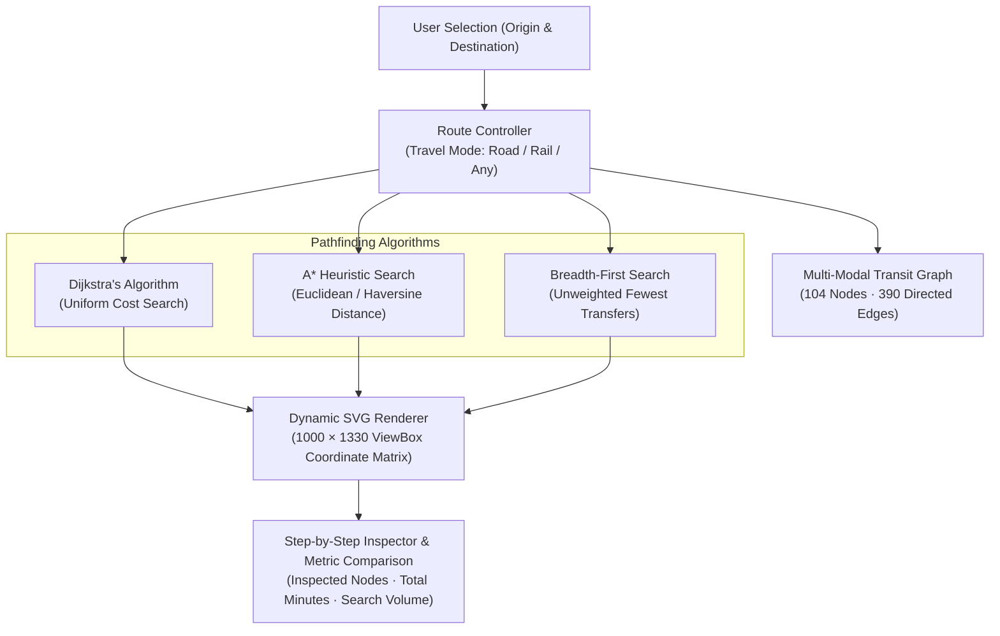

# Namma Route: Tamil Nadu Multi-Modal Transit Graph

> **Live Application:** [nammaroute-sigma.vercel.app](https://nammaroute-sigma.vercel.app/)  
> **Interactive Automated Demo:** [nammaroute-sigma.vercel.app/?demo=1](https://nammaroute-sigma.vercel.app/?demo=1)  
> **Automated Test Harness:** [nammaroute-sigma.vercel.app/?test=1](https://nammaroute-sigma.vercel.app/?test=1)  
> **Author:** [B Pradeep](https://github.com/Pradeep-B28) · [Portfolio](https://pradeep-b28.github.io/Pradeep-B28/)

---

## Overview

**Namma Route** is an interactive multi-modal transit graph engine and algorithmic visualizer modeling the geography of Tamil Nadu, India. It visualizes how classical pathfinding algorithms (Dijkstra, A*, BFS) traverse road and rail transport networks step by step, demonstrating the mathematical difference in exploration volume between uniform-cost search and directional heuristic estimation.

Built with pure Vanilla JavaScript (ES modules) and reactive vector SVG—zero external runtime dependencies or CDN frameworks.



---

## Technical Specifications & Topology

| Parameter | Specification |
| :--- | :--- |
| **Geographic Scope** | All 38 Tamil Nadu district headquarters + 17 key transit towns (55 distinct cities) |
| **Graph Topology** | Multi-modal layer: 104 logical nodes, 390 directed weighted edges |
| **Transfer Penalty** | Realistic 30-minute mode switch penalty applied when changing between road and rail |
| **Heuristic Admissibility** | Admissible Euclidean / Haversine distance heuristic with constant $k = 1.006192$ (never overestimates true transit time) |
| **Automated Verification** | Exhaustive 8,292 city-pair test suite executed across road, rail, and combined modes with zero partition failures |
| **Dependencies** | Pure Vanilla JavaScript (ES6 modules), native SVG DOM, CSS custom properties |
| **Performance** | Lighthouse Mobile Score 93+, zero cumulative layout shift (CLS = 0.00) |

---

## Dijkstra vs A*: Benchmark Comparison

In Compare Mode, both algorithms execute against the exact same journey parameters to benchmark node inspections and memory footprint:

| Journey | Mode | Optimal Travel Time | Dijkstra Inspections | A* Inspections | Search Space Reduction |
| :--- | :--- | :--- | :--- | :--- | :--- |
| **Kanyakumari → Chennai** *(North-South Corridor)* | Any (Road + Rail) | 738 min (12h 18m) | 49 cities | 16 cities | **67% fewer nodes** |
| **Coimbatore → Nagapattinam** *(West-East Corridor)* | Road | 345 min (5h 45m) | 28 cities | 11 cities | **61% fewer nodes** |
| **Tirunelveli → Vellore** | Any | 580 min (9h 40m) | 37 cities | 14 cities | **62% fewer nodes** |

*Both algorithms reliably discover the identical fastest route. A\* reaches the solution with up to 67% lower computation and memory overhead by guiding the search frontier toward the target coordinates.*

---

## Core Capabilities

1. **Precision SVG ViewBox Zoom & Pan:**
   - Smooth 1x to 4x scaling using gesture, wheel, or on-screen controls.
   - Dynamic SVG `viewBox` adjustment preserves exact coordinate registration without blurry CSS transforms.
   - Screen coordinate picking uses inverse screen matrix transforms (`getScreenCTM`) for millimeter-accurate tap targeting on mobile screens.

2. **Multi-Modal Network Modeling:**
   - **Road Layer:** National and state highways with realistic average speeds based on terrain and ghat roads.
   - **Rail Layer:** Fast long-distance express rail corridors.
   - **Combined Transit:** Realistic multi-modal trips with transfer penalty nodes.

3. **Step-by-Step Visual Execution:**
   - Real-time step inspection with adjustable animation speeds (0.25x to 4x).
   - Color-coded edge traversals and frontier tracking.

---

## Automated Verification Test Suite

The test suite validates connectivity and correctness across all city pairs in the state:
- **2,970 road pairs** tested for reachable connectivity.
- **2,352 rail pairs** tested across railway network components.
- **2,970 combined multi-modal pairs** tested with transfer penalties.
- **Total: 8,292 automated test assertions** passing with zero failures.

Run the test suite in any browser by navigating to:
```
https://nammaroute-sigma.vercel.app/?test=1
```
Or run the headless node test runner:
```bash
node test.js
```

---

## Local Development Setup

No build steps, compilation, or package manager installations are required.

1. **Clone the repository:**
   ```bash
   git clone https://github.com/Pradeep-B28/Namma_Route.git
   cd Namma_Route
   ```

2. **Serve with any local static HTTP server:**
   ```bash
   # Using Python 3
   python -m http.server 8000

   # Or using Node npx
   npx serve .
   ```

3. **Open in browser:**
   ```
   http://localhost:8000
   ```

---

## License

This project is licensed under the [MIT License](LICENSE).
